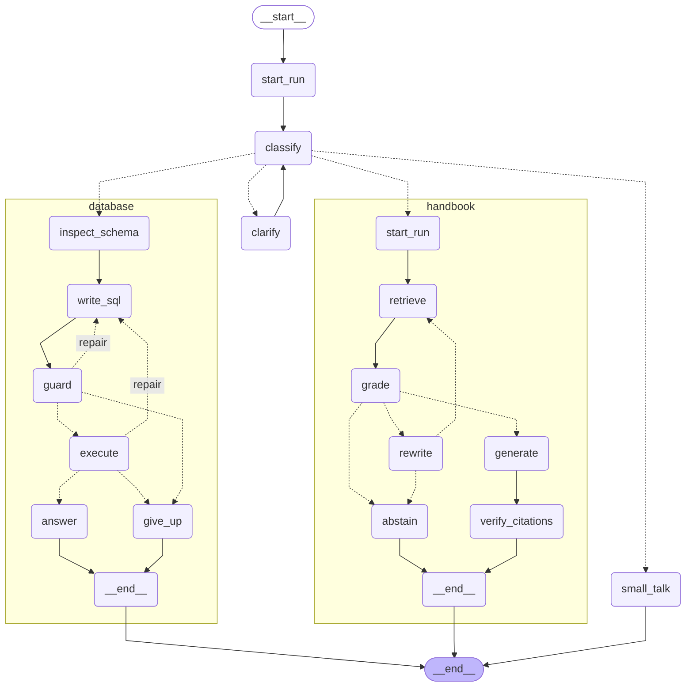

# One front door for staff questions (adaptive routing)

> Send each staff question to the handbook, the database, a quick reply or a clarifying question, and refuse to guess when the question is ambiguous.

| | |
|---|---|
| **Example id** | `adaptive_qa_router` |
| **Category** | RAG & knowledge |
| **Difficulty** | advanced |
| **Models** | OpenAI chat, OpenAI Decisions API |
| **Data** | `store.sqlite`, `kb/langgraph`, `kb/support` |
| **LangGraph features** | subgraphs with different state schemas, interrupt() for clarification, conditional routing, bounded loop via restricted schema, reuse of other examples, input/output schemas |
| **Source** | [`src/deepdive/examples/adaptive_qa_router.py`](../../src/deepdive/examples/adaptive_qa_router.py) |

---

## Problem

Staff put very different questions into the same box. "How do I use Send?" needs the written handbooks (LangGraph
and Lumen Home policies), "how many orders last month?" needs the shop database, "thanks!" needs neither, and
"what about last month?" needs a question back, because nobody can tell last month's *what*. A pipeline that
always searches documents, or always writes SQL, gets most of these wrong. Misrouting wastes time and model spend,
and guessing at an ambiguous question produces a confident answer to a question nobody asked.

## Design

One cheap classification step decides the route; the expensive specialists are reused, not rewritten.

  * `classify` (structured output) returns `route` in {handbook, database, small_talk, clarify}, a one-line
    `reason`, which knowledge base a handbook question belongs to, and, for `clarify`, ONE specific question to
    ask. The prompt says to prefer answering over asking: a vague but answerable question is not ambiguous.
  * `handbook` runs the compiled `corrective_rag` graph (grade, rewrite, abstain, verify citations) and
    `database` runs the compiled `sql_analyst` graph (guarded text-to-SQL). Their state schemas are not the
    parent's, so each is wrapped in a small function that maps parent state IN (the question, the knowledge base)
    and the subgraph's result back OUT (`answer` plus a `details` summary). Nothing from their internals
    leaks into the parent state.
  * `small_talk` is one short model reply with no factual claims about the business.
  * `clarify` calls `interrupt()` with the question to ask. The answer is appended to the question and the
    graph classifies again. Clarifying is bounded: after `MAX_CLARIFICATIONS = 2` the classifier is called with
    a schema that no longer contains `clarify` at all, so it must pick the best of the other three routes. The
    bound lives in the schema the model is given, not in a hope that it stops asking.
  The downstream specialists receive the original question plus the clarification answers as one text, so they
  see exactly what the user said.

## Graph

```text
START -> start_run (forget old clarifications) -> classify
classify --handbook----> handbook (corrective_rag subgraph) ---> END
classify --database-----> database (sql_analyst subgraph) ------> END
classify --small_talk---> small_talk ---------------------------> END
classify --clarify------> clarify (interrupt) -> classify          (the loop, at most 2 times)
```

## LangGraph features

* subgraphs with DIFFERENT state schemas, wrapped in functions that translate state in and out
* `interrupt()` for a clarifying question, resumed with `Command(resume=...)` (needs a checkpointer; Studio
  provides one). Nothing with a side effect runs before the interrupt, because the node restarts from its first
  line on resume
* conditional edges with a path map; a loop (`clarify` -> `classify`) bounded through the schema offered
  to the model
* `operator.add` reducer so clarifications accumulate, emptied with `Overwrite([])` by `start_run` so a new question
  on a reused Studio thread does not inherit them; input/output schemas
* `build_graph` builds the two subgraphs inside itself, compiled without their own checkpointer, so they inherit
  whatever persistence the parent is compiled with

## Models and data

OpenAI chat (fast model) for classification and small talk; the subgraphs bring their own models: the OpenAI
Decisions API for relevance grading in `corrective_rag` and the default chat model for SQL in `sql_analyst`.
Data: the shop database and the `langgraph` / `support` knowledge bases, through those subgraphs. Offline, the
stand-in classifier picks routes by hashing the prompt, so routes are arbitrary; `EXAMPLE_INPUT` was chosen so
that this arbitrary choice is a clarification, which keeps the offline smoke run exercising the interrupt. If you
edit the prompts, re-run `scripts/check_example.py adaptive_qa_router` and re-pick the input if the interrupt
disappears (a test fails when it does).

## Try it in Studio

Open the `Ready-made case` dropdown, pick one and press Submit (or leave the form blank on a new thread: that runs
the first one). Which route a question takes is the classifier's call, so watch `classify` for the `route`
and its `reason`:
1. `what about last month, then?` - the run pauses at `clarify` and shows the question it wants answered.
   Resume with a value such as `"Total orders placed"` (a JSON string). Watch `classify` run again and send the
   combined text ("what about last month, then? Total orders placed") to `database`.
2. `How do I pause a graph and wait for a human to approve?` -> `handbook`. Open the `handbook` node to see the
   subgraph's grading and citations in `details`.
3. `How long do refunds take?` -> `handbook` with the `support` knowledge base.
4. `Which region had the most returned orders in the last 6 months?` -> `database`; `details` carries the SQL,
   the rows and the repair history.
5. `thanks, that helped!` -> `small_talk` (neither specialist runs).
6. `and the other one?` - to see the cap, answer each clarification with something equally vague; after two, the
   classifier can no longer ask and must pick a route.
To ask your own, paste `{"question": "what about last month, then?"}` (any question works).

## Extend it

* Add a `tools` route (an agent with a calculator) and let the classifier choose it.
* Keep the conversation in `messages` so a follow-up like "and for Europe?" can reuse the previous route.
* Replace the classifier with a Decisions API `choice` question to get calibrated route probabilities, and
  clarify automatically when the top route is below a threshold.

## Compiled graph

Drawn from the compiled graph by `scripts/gen_docs.py` (one level of subgraphs expanded).



## Ready-made cases in Studio

The input form has a **Ready-made case** dropdown, so you do not need to know the data. Pick one and press Submit; a blank form on a new thread runs the first.

| # | Case (as shown in the dropdown) | Input it stands for |
|---|---|---|
| 1 | what about last month, then? -> no subject: watch for a clarifying question, then type an answer in the Resume box | `{"question": "what about last month, then?"}` |
| 2 | How do I pause a graph and wait for a human to approve? -> watch for the handbook route (LangGraph) with citations | `{"question": "How do I pause a graph and wait for a human to approve?"}` |
| 3 | How long do refunds take? -> watch for the handbook route on the support policies, not the LangGraph docs | `{"question": "How long do refunds take?"}` |
| 4 | Which region had the most returned orders in the last 6 months? -> watch for the database route: SQL and rows in details | `{"question": "Which region had the most returned orders in the last 6 months?"}` |
| 5 | thanks, that helped! -> watch for small_talk: neither the handbook nor the database runs | `{"question": "thanks, that helped!"}` |
| 6 | and the other one? -> a dangling reference: keep answering vaguely and see the 2-question cap force a route | `{"question": "and the other one?"}` |

## Example input

```json
{
  "question": "what about last month, then?"
}
```

Resume values (answers to the interrupts, in order):

```json
[
  "Total orders placed",
  "How many orders were placed?"
]
```

Run it: `uv run langgraph dev`, open Studio, choose `adaptive_qa_router`, pick a case from the **Ready-made case** dropdown, or paste the input above.
