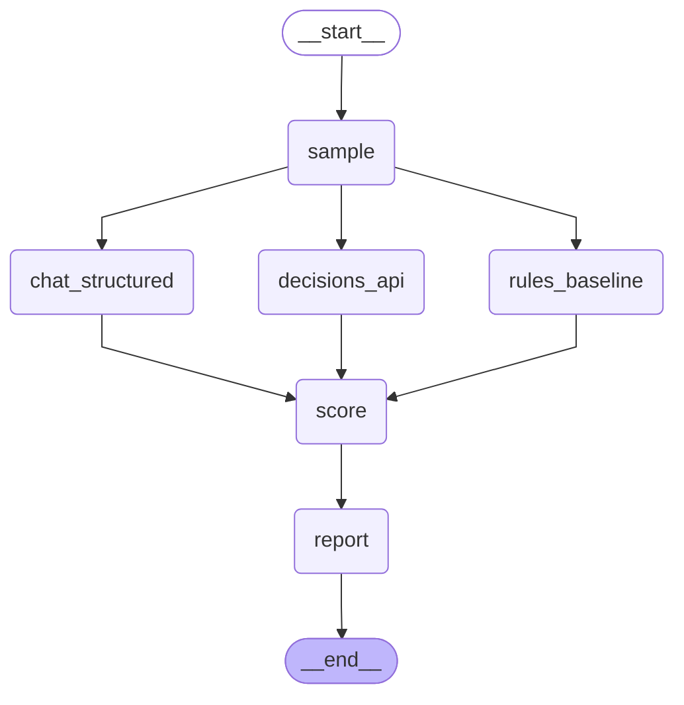

# Classifier bake-off: rules vs LLM vs Decisions API

> Measure which approach (keyword rules, a structured-output LLM, or the Decisions API) should classify market headlines, on accuracy, hard cases, calibration, agreement, latency and tokens.

| | |
|---|---|
| **Example id** | `classifier_bakeoff` |
| **Category** | Decisions API |
| **Difficulty** | advanced |
| **Models** | OpenAI chat, OpenAI Decisions API |
| **Data** | `news_headlines.csv` |
| **LangGraph features** | parallel branches + reducer, per-node input_schema, batching, Decisions API at scale, evaluation harness |
| **Source** | [`src/deepdive/examples/classifier_bakeoff.py`](../../src/deepdive/examples/classifier_bakeoff.py) |

---

## Problem

A trading-signal team wants to classify market headlines as positive, negative or neutral and is arguing about how:
cheap keyword rules, an LLM that returns structured labels, or the Decisions API, which returns calibrated
probabilities. Opinions are not evidence. The labelled file `news_headlines.csv` (180 headlines, about 15% deliberately
tricky or mixed, such as "beats estimates but slashes outlook") lets the team measure instead: accuracy, accuracy on the
hard headlines, how trustworthy each method's confidence is, how often the methods agree, and what each costs in time
and tokens. This graph is that measurement as a repeatable harness.

## Design

* One stratified, deterministic sample (`seed`). The strata are label x "hard", so the hard headlines (those containing
  "but", "despite", "yet", "only after", ";" and similar) are represented in the same proportion as in the full file even
  in a small sample. The same `seed` always gives the same headlines.
* Three classifiers run as PARALLEL BRANCHES from the sample node and write to a shared list through a reducer. Each one
  receives only the headline texts, never the labels: the nodes declare an `input_schema` with a single field, so
  leakage is impossible by construction rather than by discipline.
    - `rules_baseline`: a small lexicon of everyday finance words (written from general vocabulary, not tuned to this
      file). It is free and instant, has no notion of confidence, and by construction cannot read "good news, but...".
    - `chat_structured`: an OpenAI chat model, 10 headlines per call, structured output
      `{headline_id, label, confidence}` per headline. Confidence is the model's own claim.
    - `decisions_api`: ONE request with a `choice` question per headline (up to 400 are allowed; the sample is capped
      at 90). The probability of the chosen option is the confidence. Both LLM methods get the same label definitions, so
      the comparison is about the method, not about different instructions.
* `score` is plain code: accuracy, macro-F1, confusion matrix, accuracy on the hard and easy subsets, and for the methods
  that give a confidence a top-label Brier score and a 5-bin expected calibration error (ECE), plus pairwise agreement.
  Everything is hand-coded (no sklearn) and unit-tested against hand-computed examples. A headline a method failed to
  answer counts as wrong, never silently dropped.
* `report` renders a deterministic comparison table and asks a chat model for a short verdict. The verdict must quote the
  table: a guard checks that it repeats at least three of the table's numbers and otherwise replaces it with a verdict built
  by code. A branch that crashes (for example an API outage) is reported as `failed` and does not stop the others.

Calibration definitions: top-label Brier = mean over answered headlines of (confidence - 1[correct])^2; ECE = sum over 5
equal-width confidence bins of (bin share) x |bin accuracy - bin mean confidence|. Lower is better for both. The rules
baseline has no confidence, so it has neither.

IMPORTANT, about offline runs: offline, the chat and Decisions API stand-ins return arbitrary but stable labels, so the
accuracy numbers you see offline are MEANINGLESS. The pipeline (sampling, batching, parallel branches, scoring, the
report) is exercised; the numbers are not. A live run, with `OPENAI_API_KEY` set, is what answers the question; the
output says `mode` and prints a caveat when it is offline. Also: the headlines are generated from about two dozen
templates, so plain headlines are easy for every method; the hard subset is where methods differ, and with a sample of 30
it holds only 5 or 6 headlines, so differences of a few points are noise. Use `sample_size` 90 for a firmer comparison.

## Graph

```text
START -> sample --+--> rules_baseline --+
                  +--> chat_structured -+--> score -> report -> END
                  +--> decisions_api ---+
                    (each sees only the headline texts)
```

## LangGraph features

* Parallel branches from one node and a join (`add_edge([...], "score")`) that waits for all three.
* A reducer (`operator.add`) so parallel branches can append to the same state key.
* Per-node `input_schema` to hide the labels from the classifiers.
* The Decisions API at scale: one batched request, one question per headline, probabilities read per question.
* Batching: 10 headlines per chat call, run concurrently, with usage tokens summed from the responses.
* An evaluation harness expressed as a graph: sampling, runs, metrics and report as separate, testable nodes.

## Models and data

OpenAI chat (fast tier) for `chat_structured` and for the verdict; the Decisions API for `decisions_api`. Data:
`news_headlines.csv` (180 rows: id, date, ticker, headline, label). Token counts come from the providers' usage fields;
cost is not computed because prices change. Latency is wall-clock per branch, measured inside the node.

## Try it in Studio

Input `{"sample_size": 30, "seed": 0}`. Open `score` to see the metrics per classifier and `report` for the
comparison table (markdown) and the verdict. Then:
  * `{"sample_size": 90, "seed": 0}`: the largest run (90 Decisions questions, 9 chat calls).
  * the same `sample_size` with `"seed": 1`: a different, equally stratified sample, to see how much the ranking moves.
With a live key, read the `hard acc` column first: that is where the methods separate. Offline, ignore the numbers.

## Extend it

Add a fourth branch (a small fine-tuned classifier, or the chat model with few-shot examples); weight the hard subset
by what a wrong signal costs; or add a bootstrap confidence interval to `score` so the table says how big the noise is.

## Compiled graph

Drawn from the compiled graph by `scripts/gen_docs.py` (one level of subgraphs expanded).



## Example input

```json
{
  "sample_size": 30,
  "seed": 0
}
```

Run it: `uv run langgraph dev`, open Studio, choose `classifier_bakeoff`, paste the input above.
