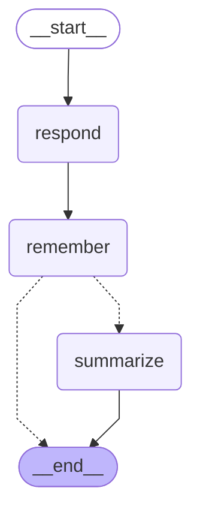

# Short-term memory: window, rolling summary and pinned facts

> Keep a 100-turn support chat cheap and within context without forgetting the customer's name, order numbers or what the assistant promised, by combining a bounded window, a rolling summary and pinned facts.

| | |
|---|---|
| **Example id** | `conversation_memory` |
| **Category** | Memory & streaming |
| **Difficulty** | intermediate |
| **Models** | OpenAI chat |
| **Data** | - |
| **LangGraph features** | checkpointer thread memory, add_messages + RemoveMessage, rolling summary, trim_messages window, pinned facts with a reducer, conditional edge, token streaming + custom events |
| **Source** | [`src/deepdive/examples/conversation_memory.py`](../../src/deepdive/examples/conversation_memory.py) |

---

## Problem

A support chat can run for 100 turns. Sending the whole history every turn costs more with every message and
eventually overflows the context window. Cutting it off at the last N messages is cheap but makes the assistant
forget the very things that matter: the customer's name, which order they are talking about, and what the
assistant itself promised ("I'll email a return label by Friday"). A support assistant that forgets its own
commitments is worse than one that never made them.

## Design

Memory is split by how much it hurts to lose, and each kind lives in its own state field, persisted per
`thread_id` by the checkpointer (with a durable one, the same chat can continue tomorrow in another process):

  * `messages`  the recent verbatim window. Bounded: once it exceeds `max_messages` (default 12) the oldest
                  messages are folded away until `keep_last` (default 6) remain. Both are state fields you can
                  override in the input, per thread.
  * `summary`   a rolling summary of everything that was folded away. A chat model rewrites it each time
                  ("previous summary + the messages being removed -> updated summary"); the prompt tells it to
                  keep commitments, open issues, amounts, dates and stated preferences and to drop pleasantries.
                  It is lossy by nature, which is why it is not the only safety net:
  * `facts`     PINNED memory that is never dropped and never summarised: customer name, order numbers, and
                  the assistant's commitments. Each turn a small structured-output call extracts them from the
                  new messages, and a deterministic regex also catches order numbers ('#1042', 'order 1042')
                  whatever the model returns, because a missed order number is the costliest miss. The `facts`
                  field has a reducer (`merge_facts`) so the merge rule lives with the state, not in whichever
                  node writes it: lists are unioned and de-duplicated, and an empty value can never overwrite
                  a real one. Lists are capped at 30 entries per kind to keep the prompt bounded; past that the
                  oldest entry is the one that goes.

Every `respond` prompt is built from: the instructions, then the pinned facts, then the summary (if any), then
the messages still in the window. The window passed to the model is also trimmed to `max_messages + 1` as a
safety net (for example if an input pastes in a 40-message history); the usual state is already bounded by
folding.

Order of nodes: `respond` first, then `remember` (it can see what the assistant just promised), then
a conditional edge `maybe_summarize` that goes to `summarize` only when the window is over its limit.
The reply streams before the summariser runs, so the customer never waits for it. After every turn the stored
window holds at most `max_messages` messages; when the next user message arrives that is at most
`max_messages + 1`, which is exactly what `respond` sends, so nothing is ever left out of a prompt before it
has been summarised. The cost is two model calls per turn (the reply, and fact extraction on the cheaper model)
plus a third, the summary, every `(max_messages - keep_last) / 2 + 1` turns (every 4th turn with the defaults).

Failure rules: if fact extraction raises, the turn still completes and the regex net still pins order numbers; if
the summariser returns nothing, NO messages are removed (they would be lost) and it simply tries again next turn.

Streaming: `respond` is the only node whose model output is meant for the customer. The extractor and summariser
calls are tagged `nostream` so `stream_mode="messages"` shows only the reply tokens (filtering on
`metadata["langgraph_node"] == "respond"` works too). Memory changes are emitted as `stream_mode="custom"`
events (`memory_updated`, `summarized`) so a UI can show "remembered order #1042".

## Graph

```text
START -> respond -> remember -> maybe_summarize --(window > max_messages)--> summarize -> END
                                       |
                                       +--(otherwise)-----------------------------------> END
```

## LangGraph features

* checkpointer-backed thread memory (state persists per `thread_id`; threads are isolated)
* `add_messages` plus `RemoveMessage` returned from a node to delete old messages from state
* a rolling-summary field and a trimming policy (`trim_messages` as a prompt-side safety net)
* pinned structured memory with a custom reducer on a state key
* a conditional edge that decides whether the summariser runs
* token streaming (`stream_mode="messages"`) with internal calls hidden, and `get_stream_writer` custom events
* `input_schema` / `output_schema` with a `messages` key so Studio's chat view works

## Models and data

OpenAI chat: the reply model (default tier), and the fast tier for fact extraction (structured output) and
summarising. No dataset, no retrieval: this example is about memory, so the assistant answers from the
conversation alone and the prompt forbids inventing order data it cannot see. Offline mode uses placeholder
replies and a stub extractor, so the pinned facts you see offline are stub text; the mechanics (folding, bounds,
ordering, isolation) are exactly the same and are what the tests check.

## Try it in Studio

1. Open the graph in chat mode (or graph mode with a `messages` list) and send, as separate turns:
   "Hi, I'm Priya. My order #1042 arrived with a cracked case." / "Can you refund it?" / then ten or so
   unrelated questions ("how do I reset the hub?", "what is the warranty on the lock?", ...).
2. To see folding fast, use graph mode and put `"max_messages": 6, "keep_last": 2` in the first input.
   Watch the state panel after each turn: `messages` stops growing, `summary` appears and is rewritten,
   `folded_messages` climbs, and `facts` keeps the name, the order number and the assistant's promise.
3. Ask "which order were we talking about?" long after the first message is gone. The reply is possible because
   the order number is in `facts`, not in the window. If LangSmith tracing is on, the trace of `respond` shows the
   exact prompt (instructions, pinned facts, summary, last messages) the model was given; the tests capture it too.
4. Start a second thread: it has its own messages, summary and facts.

## Extend it

Move `summarize` into a background run so the reply never shares a run with it. Count tokens instead of
messages (`trim_messages(token_counter=model)`). Promote the pinned facts to the LangGraph Store so they follow
the customer across threads: that is long-term memory, a different mechanism from this per-thread state.

## Compiled graph

Drawn from the compiled graph by `scripts/gen_docs.py` (one level of subgraphs expanded).



## Example input

```json
{
  "messages": [
    {
      "role": "user",
      "content": "Hi, I'm Priya. My order #1042 arrived with a cracked case. Can you help?"
    }
  ]
}
```

Run it: `uv run langgraph dev`, open Studio, choose `conversation_memory`, paste the input above.
