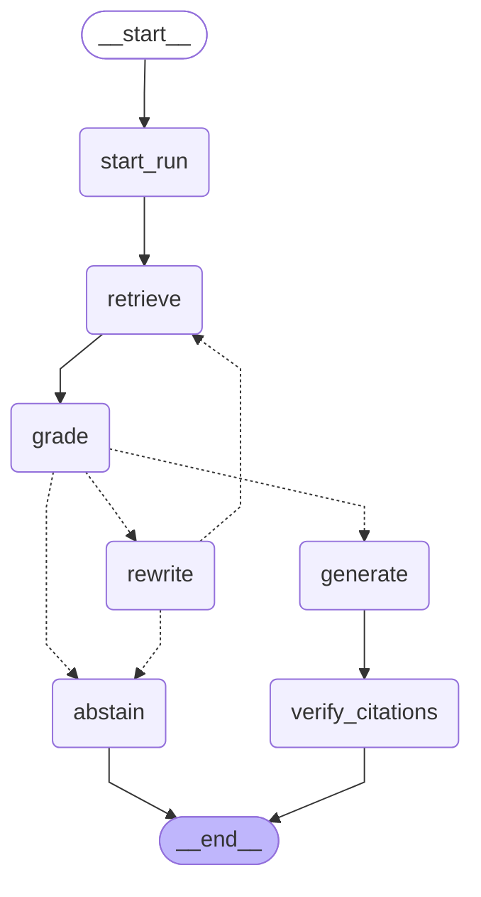

# Ask the LangGraph handbook (corrective RAG)

> Stop keyword retrieval from producing confident answers built on plausible but wrong articles, by grading what was retrieved, rewriting the query when needed, and abstaining when the knowledge base does not cover the question.

| | |
|---|---|
| **Example id** | `corrective_rag` |
| **Category** | RAG & knowledge |
| **Difficulty** | intermediate |
| **Models** | OpenAI Decisions API, OpenAI chat |
| **Data** | `kb/langgraph`, `kb/support` |
| **LangGraph features** | Decisions API batch grading, retry loop with query rewriting, abstain path, deterministic post-check, reducers across loop rounds, structured output |
| **Source** | [`src/deepdive/examples/corrective_rag.py`](../../src/deepdive/examples/corrective_rag.py) |

---

## Problem

Keyword retrieval returns articles that share words with the question, not articles that answer it. Ask the
handbook "How do I pause a graph and wait for a human to approve?" and BM25 ranks the article on Send fan-out,
the one on checkpointers and the one on subgraphs above the article on `interrupt()` - all plausible, only one
right. A naive RAG graph pastes the top hits into a prompt and writes a fluent, confident answer from whatever
it got, including from the wrong articles. For documentation that people act on, "I could not find that" is a far
better outcome than a confident answer built on the wrong page.

## Design

Retrieval is cheap and unreliable, so the graph *checks* what it retrieved before it writes anything, and it
treats "nothing relevant" as a legitimate result instead of something to paper over.

  * `retrieve` takes the top 4 BM25 hits (a deliberately wide net).
  * `grade` asks one question about each hit - "does this article contain information needed to answer the
    question?" - and sends ALL of them in a single Decisions API call (one `predicate` per article). The API
    returns a calibrated probability per article, not a yes/no, so the cut-off is an explicit, tunable number:
    `RELEVANCE_THRESHOLD = 0.6`. The probabilities are kept in the output, so you can see how close a
    discarded article was. A refused answer counts as "not relevant".
  * If at least one article passes, `generate` writes the answer from ONLY those articles.
  * If none passes, `rewrite` (an LLM with structured output) writes a new keyword query using the
    documentation's own vocabulary, and the graph retrieves again. At most `MAX_REWRITES = 2` rewrites. A
    rewrite that repeats an earlier query ends the search at once (nothing new would be found).
  * If the budget is spent, `abstain` replies "not covered", lists the closest articles with their grader
    probabilities, and never calls the generator. This is deterministic text: the model is never asked to
    write from context it has just been told is irrelevant.
  * `verify_citations` is a deterministic post-check. The generator is told to cite `[article-id]`; any cited
    id that was not among the articles it was given is stripped from the answer and reported in
    `dropped_citations`. Any lowercase slug in square brackets counts as a citation attempt (so a shortened id
    such as `[checkpointers]` cannot slip through), which is why the generator is told to use brackets for
    nothing else; code spans and `[text](link)` are left alone. An answer left with no valid citation is
    flagged `answered_uncited` and carries a caveat, because it cannot be checked against any source.
  Grading is always against the ORIGINAL question, never the rewritten query, so a rewrite cannot change what
  "relevant" means.

## Graph

```text
START -> start_run (reset per-run state) -> retrieve -> grade
grade   --some article scores >= 0.6--------> generate -> verify_citations -> END
grade   --none pass, rewrites left----------> rewrite --new query--> retrieve      (the loop, at most 2 times)
grade   --none pass, no rewrites left-------> abstain -> END
rewrite --repeated an earlier query---------> abstain -> END
```

## LangGraph features

* a retry loop (retrieve -> grade -> rewrite -> retrieve) with its bound held in state and enforced by the
  routing function; `queries` and `grading` accumulate across rounds through `operator.add` reducers, and
  `start_run` empties them with `Overwrite([])` so a new question on a reused Studio thread starts clean
* conditional edges with explicit path maps, so the three exits of `grade` are named in Studio
* input/output schemas (Studio shows `question` and `corpus`; the result shows the evidence)
* structured output (the rewrite) and the OpenAI Decisions API (batched grading) in one graph
* a deterministic final node that audits model output

## Models and data

Decisions API for the relevance grades (one call per retrieval round, one predicate per article), OpenAI chat
for the rewrite (fast model) and the answer (default model). Data: the `langgraph` handbook (15 short
articles; default) or the `support` policies (10 articles; internal-only ones are never retrieved). Offline,
the grader returns arbitrary but stable probabilities and the chat model returns placeholder text, so an
offline run shows the shape of the output, not good answers; `mode` in the output says which ran.

## Try it in Studio

Input `{"question": "How do I pause a graph and wait for a human to approve?"}`. Open the `retrieve` output,
then `grade`: compare the BM25 order with the probabilities (the interrupts article is retrieved 4th but is
the one that should pass). Then try
  * `{"question": "How can I let a person sign off before the workflow continues?"}` - weak vocabulary overlap,
    so expect a `rewrite` and a second round;
  * `{"question": "What is the capital of France?"}` - no article shares a word with it, so there is nothing to
    grade; expect up to two rewrites and then `abstain` with no generation;
  * `{"question": "How long do refunds take?", "corpus": "support"}`.
In the output, `grading` lists every round (query, articles, probabilities, kept or not), `sources` the
articles the answer was allowed to use, and `dropped_citations` any citation that was removed.

## Extend it

* Cache grades per (question, article) so a rewrite that re-retrieves a known article does not pay for it again.
* Replace the BM25 retriever with embeddings plus BM25 and keep the same grade/rewrite/abstain wrapper.
* Add a second Decisions API check after `generate` ("is every claim supported by the kept articles?") and
  route low-support answers to `abstain`.

## Compiled graph

Drawn from the compiled graph by `scripts/gen_docs.py` (one level of subgraphs expanded).



## Example input

```json
{
  "question": "How do I pause a graph and wait for a human to approve?"
}
```

Run it: `uv run langgraph dev`, open Studio, choose `corrective_rag`, paste the input above.
