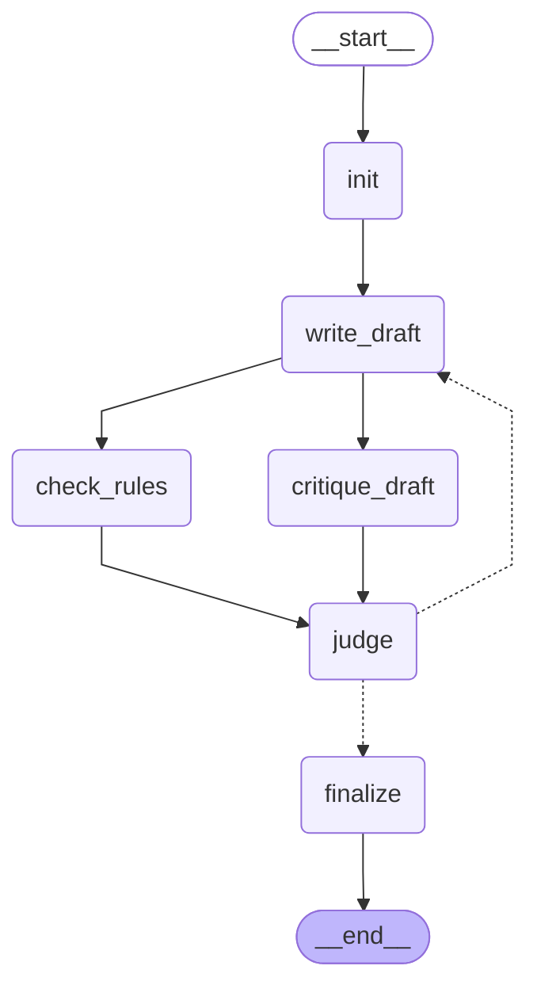

# Draft, critique, revise (bounded)

> Produce a launch announcement that satisfies hard rules (length, required facts, banned claims) and a quality bar, revising until it passes or an explicit attempt cap returns the best draft, flagged as best-effort.

| | |
|---|---|
| **Example id** | `draft_critic_loop` |
| **Category** | Core workflows |
| **Difficulty** | starter |
| **Models** | OpenAI chat |
| **Data** | - |
| **LangGraph features** | cycle with explicit cap, conditional edges, parallel critics + join edge, append-only reducer, input/output schemas |
| **Source** | [`src/deepdive/examples/draft_critic_loop.py`](../../src/deepdive/examples/draft_critic_loop.py) |

---

## Problem

Marketing must publish a product-launch announcement under hard constraints: at most 120 words, three specific
facts mentioned word for word (price, warranty, return window), and none of the claims legal has banned ("best",
"guaranteed", "#1", "revolutionary" ...). It also has to read well. A model's first draft often breaks a rule,
and asking a model to check its own work is unreliable for rules that are easy to count: models miscount words and
overlook a banned word they just wrote.

## Design

Two critics with different jobs, run side by side on every draft:

  * `check_rules`    deterministic code: word count, required phrases present verbatim (case-insensitive),
                       banned phrases absent. It cannot be talked out of a verdict. Matching required facts as
                       exact phrases is strict on purpose: "two-year warranty" does not satisfy "24-month
                       warranty", and the revision prompt names the phrase that is missing.
  * `critique_draft` an LLM editor that scores tone and clarity (1-10) and gives concrete edits. It is told NOT to
                       judge the rules above, because code already does.

`judge` joins them, records the attempt, and decides: approved (no rule violations AND editor score >= 7), out of
attempts (`iteration >= max_iterations`), or revise. The revision prompt contains the rule failures spelled out
("Too long: 143 words, the limit is 120") plus the editor's notes, so the generator fixes what is actually wrong.

Two decisions keep the loop honest. (1) The cap is a counter in state with an input (`max_iterations`, default
3), because LangGraph's own recursion limit is 10007 steps and would let a stubborn critic run up a large bill
first. (2) When the cap is reached the graph returns the BEST attempt, ranked by fewest rule violations and then by
editor score, not simply the last one: revisions can make a draft worse. The result is labelled
`status="best_effort"` with the unresolved problems listed, so nobody mistakes it for an approved draft.
Every attempt stays in an append-only `history` so you can see how the draft evolved.

## Graph

```text
START -> init -> write_draft --+--> check_rules ------+--> judge --(passed, or out of attempts)--> finalize -> END
                     ^         +--> critique_draft ---+      |
                     |                                      |
                     +----------------(revise)--------------+
```

## LangGraph features

* a cycle (`judge` -> `write_draft`) guarded by an explicit counter in state
* `add_conditional_edges` for the loop / stop decision
* parallel nodes joined with `add_edge([a, b], "judge")` (`judge` waits for both critics)
* an append-only `operator.add` reducer for the attempt history, reset with `Overwrite([])` at the start of a run
* separate `input_schema` / `output_schema`

## Models and data

OpenAI chat model (plain text for the writer, structured output for the editor). No dataset is read: the default
facts are real facts from the bundled data ($149 is the Lumen Therm price in `sales.csv` after the May cut;
the 24-month thermostat warranty and 30-day returns are in `kb/support`).
Offline, the stand-in writer echoes the prompt and the stand-in editor gives a fixed score, so you will see the
loop run to its cap and return a `best_effort` result: that is the cap behaviour working, not a failure.

## Try it in Studio

Pick a ready-made case from the "Ready-made case" dropdown and press Submit (a blank form on a new thread runs the
first one). Open the `history` field of the output to read every attempt with its rule violations and score:
  * Therm ($149, 24-month warranty, 30-day returns): the standard run; watch whether the loop converges within
    the default three drafts. The facts are real: $149 is the Therm price after the May cut (`sales.csv`), and
    the 24-month warranty and 30-day returns are in `kb/support`.
  * Plug 4-pack with `max_words` 30: a tight limit, so look for a "Too long" violation and a shorter revision.
  * Lock with `max_iterations` 1: exactly one draft, so no revision (approved, or best_effort at once).
  * Therm with the required fact "best-in-class": "best" is a banned claim, so no draft can satisfy both rules; the
    loop stops after `max_iterations` drafts and returns the best one as `status="best_effort"`, with `unmet`
    saying what is still wrong. Therm with 16 words of required facts in a 10-word limit fails the same way.
Or paste your own input, for example `{"product": "Lumen Therm", "required_facts": ["$149", "24-month warranty",
"30-day returns"], "max_iterations": 2}`.

## Extend it

Add a `banned_phrases` input that extends the built-in list. Replace the editor score with a Decisions API
`score` question so the pass threshold works on a calibrated probability. Add `interrupt()` when the loop ends
as `best_effort` so a person can choose between attempts.

## Compiled graph

Drawn from the compiled graph by `scripts/gen_docs.py` (one level of subgraphs expanded).



## Ready-made cases in Studio

The input form has a **Ready-made case** dropdown, so you do not need to know the data. Pick one and press Submit; a blank form on a new thread runs the first.

| # | Case (as shown in the dropdown) | Input it stands for |
|---|---|---|
| 1 | Lumen Therm: $149, 24-month warranty, 30-day returns -> watch for it to converge within the default 3 drafts | `{"product": "Lumen Therm", "required_facts": ["$149", "24-month warranty", "30-day returns"]}` |
| 2 | Lumen Plug 4-pack: $39, 12-month warranty, 30-day returns, max 30 words -> watch for 'Too long', then a shorter draft | `{"product": "Lumen Plug 4-pack", "required_facts": ["$39", "12-month warranty", "30-day returns"], "max_words": 30}` |
| 3 | Lumen Lock: $179, 24-month warranty, 30-day returns, max 1 draft -> exactly one draft, never revised | `{"product": "Lumen Lock", "required_facts": ["$179", "24-month warranty", "30-day returns"], "max_iterations": 1}` |
| 4 | Lumen Therm: required fact 'best-in-class' is a banned claim -> can never pass: best_effort after 3 drafts | `{"product": "Lumen Therm", "required_facts": ["$149", "best-in-class"]}` |
| 5 | Lumen Therm: 16 words of required facts in a 10-word limit -> can never pass: best_effort after 3 drafts | `{"product": "Lumen Therm", "required_facts": ["$149 after the May price cut", "24-month warranty on the thermostat", "30-day returns on unused units"], "max_words": 10}` |

## Example input

```json
{
  "product": "Lumen Therm",
  "required_facts": [
    "$149",
    "24-month warranty",
    "30-day returns"
  ]
}
```

Run it: `uv run langgraph dev`, open Studio, choose `draft_critic_loop`, pick a case from the **Ready-made case** dropdown, or paste the input above.
