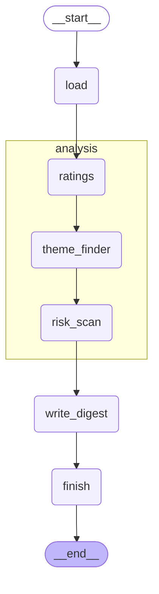

# Live customer-voice digest (streaming)

> Stop users resubmitting a slow report by streaming typed progress, partial results and the digest's tokens, with subgraph-aware events a front-end can consume directly.

| | |
|---|---|
| **Example id** | `live_digest_stream` |
| **Category** | Memory & streaming |
| **Difficulty** | intermediate |
| **Models** | OpenAI chat |
| **Data** | `product_reviews.csv` |
| **LangGraph features** | get_stream_writer custom events, multi-mode streaming (updates/messages/custom), subgraph streaming with namespaces, token streaming with node filtering, subgraph as a node |
| **Source** | [`src/deepdive/examples/live_digest_stream.py`](../../src/deepdive/examples/live_digest_stream.py) |

---

## Problem

The weekly customer-voice digest is slow: load the reviews, run three analysis stages, then an LLM writes the
summary. Behind a bare spinner users assume it has hung, refresh, and resubmit - doubling the cost and the wait.
The fix is not a faster graph but a graph that *talks while it works*: a progress bar that only moves forward,
the rating histogram on screen the moment it exists, and the digest typing itself out token by token.

## Design

Streaming is a contract between the graph and a front-end, so it is designed, not sprinkled:

  * Every stage reports through `get_stream_writer()` with two typed events:
    `{"type": "progress", "stage", "pct", "message"}` and `{"type": "partial", "name", "data"}`. `pct` only
    ever increases and the last event of a successful run is 100, so a UI can render it without special cases.
  * Which parts are deterministic code and which are model: ratings and risk flags are plain code (a safety
    signal must not depend on a model's mood). Themes are proposed by a model but *verified* by code: it must cite
    review ids, code drops ids it did not load, recomputes counts and average ratings itself, and falls back to a
    keyword tally if nothing survives. Only the final write-up is free text, and only that text is streamed to
    the user.
  * The analysis stages live in a **subgraph** so the front-end can show "analysis: step 2 of 3" and Studio can
    drill into it. Streaming with `subgraphs=True` labels every event with the subgraph it came from.
  * Internal model calls emit tokens too. `stream_mode="messages"` reports *every* chat-model call made inside
    the graph (checked offline with a plain call in a non-UI node; the theme classifier's structured-output call is
    expected to stream its raw JSON the same way live, which I could not check offline), so a naive UI could print
    classifier JSON into the digest. `iter_ui_events` below keeps only tokens from the `write_digest` node. (Alternative on the producer side: tag the internal call
    with `.with_config(tags=["nostream"])` and LangGraph never emits its tokens; checked offline. The consumer
    filter is used here because the UI owner should not need to edit every node.)
  * The module ships the front-end half: `iter_ui_events` turns the raw multi-mode stream into small
    normalised events, and `python -m deepdive.examples.live_digest_stream` is a terminal "UI" built on it.

## Graph

```text
    START -> load -> [ analysis: ratings -> theme_finder -> risk_scan ] -> write_digest -> finish -> END
                      (a subgraph; its three steps stream under namespace "analysis:<id>")

STREAM MODES (``graph.stream(input, config, stream_mode=...)``)
    +--------------+---------------------------------+-----------------------------+------------------------------+
    | mode         | yields                          | use it for                  | in this example              |
    +--------------+---------------------------------+-----------------------------+------------------------------+
    | values       | the full state after each step  | "what does the state look   | not used (it would resend    |
    |              |                                 | like now" (can be large)    | all the reviews each step)   |
    | updates      | {node: what that node returned} | per-stage "done" ticks      | ``stage_done`` events        |
    | messages     | (AIMessageChunk, metadata) per  | the typing effect; metadata | ``token`` events, filtered   |
    |              | token of EVERY model call       | has ``langgraph_node``      | to ``write_digest``          |
    | custom       | whatever a node passes to       | progress bars, partial      | ``progress`` and ``partial`` |
    |              | ``get_stream_writer()``         | results, domain events      | events                       |
    | debug        | checkpoints plus task start /   | tracing and post-mortems    | not used (``tasks`` and      |
    |              | finish with full config         |                             | ``checkpoints`` are subsets) |
    +--------------+---------------------------------+-----------------------------+------------------------------+
    | subgraphs=   | prefixes every item with a      | knowing WHERE an event came | ``path`` / ``ns`` on every   |
    | True         | namespace tuple                 | from; without it subgraph   | normalised event             |
    +--------------+---------------------------------+-----------------------------+------------------------------+
    Verified shape in langgraph 1.2.20: with a LIST of modes and ``subgraphs=True`` every item is a 3-tuple
    ``(namespace, mode, payload)``. ``namespace`` is ``()`` for the parent graph and ``("analysis:<task id>",)`` inside
    the subgraph (one entry per nesting level). The namespace is present even with no checkpointer. With a single
    mode and no subgraphs you get the bare payload; with ``version="v2"`` you get dicts ``{"type", "ns", "data"}``
    instead (this module uses the default tuples).
    What you see in Studio: the run view lights up nodes as they finish, the ``analysis`` node expands into its three
    steps, and the final state appears in the state panel. Studio is not a stream-event inspector (how it renders
    custom events depends on its version - not verified here); to see the exact events a front-end receives, run the
    command under TRY IT IN STUDIO.
```

## LangGraph features

* `get_stream_writer()` custom events - progress and partial results are domain events no built-in mode has
* `stream_mode=["updates", "messages", "custom"]` together, and `subgraphs=True` for namespaces
* a compiled subgraph added directly as a node (shared state keys), so its inner steps are streamable
* token streaming from a plain `llm.invoke` inside a node: LangGraph streams under the hood when a
  `messages` consumer is attached, so the node needs no streaming code
* separate `input_schema` / `output_schema` and a structured-output call whose result is verified by code

## Models and data

OpenAI chat: a `fast` model for the theme classifier (structured output), the default model for the digest.
Data: `product_reviews.csv` (320 reviews of the eight Lumen Home products; newest `max_reviews` are used).
Simulated: nothing about the streaming is simulated, but offline mode streams a canned reply word by word and
returns instantly, so `pace_s` (sleep per stage) exists purely to make the progress visible in a demo.

## Try it in Studio

Input `{"product": "Lumen Plug 4-pack", "max_reviews": 40, "pace_s": 0.5}`. Watch `load`, then the `analysis`
subgraph (expand it for its three steps), `write_digest` and `finish`; open `risk_scan` to see the burning
plug review (R-0315) flagged. Try `"Lumen Lock"` for lock-out risks and `"Nope"` for the clean error.
To see the event stream itself, run in a terminal (add `--pace 0.3` to slow it down)::

    .venv/bin/python -m deepdive.examples.live_digest_stream "Lumen Plug 4-pack"

## Extend it

Handle the resubmit itself: a run submitted while another is active on the same thread can be rejected, queued or
allowed to interrupt the old one (the server's multitask options) - decide which fits your UI. Add a cancel check
between stages so an abandoned run stops spending model calls. Emit the digest's sections as separate `partial`
events by splitting the write-up into one model call per section.

## Compiled graph

Drawn from the compiled graph by `scripts/gen_docs.py` (one level of subgraphs expanded).



## Example input

```json
{
  "product": "Lumen Plug 4-pack",
  "max_reviews": 40
}
```

Run it: `uv run langgraph dev`, open Studio, choose `live_digest_stream`, paste the input above.
