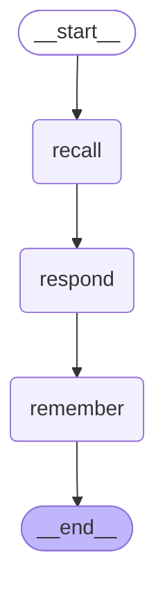

# Shopping concierge with long-term memory

> Remember customer preferences across separate conversations, let them take facts back, and never persist card numbers, passwords or other secrets.

| | |
|---|---|
| **Example id** | `memory_concierge` |
| **Category** | Memory & streaming |
| **Difficulty** | intermediate |
| **Models** | OpenAI chat |
| **Data** | - |
| **LangGraph features** | BaseStore injection, namespaces, semantic search, runtime context, structured extraction, cross-thread persistence, token streaming |
| **Source** | [`src/deepdive/examples/memory_concierge.py`](../../src/deepdive/examples/memory_concierge.py) |

---

## Problem

A returning customer should not have to repeat themselves: "three-storey house, wifi dead zones upstairs",
"I like Matter-compatible gear", "no subscriptions, please". Thread state cannot help, because a checkpoint belongs
to ONE conversation; the next chat starts empty. Naively saving "everything the customer said" fixes that and
creates new problems: duplicates pile up, facts go stale, the customer cannot take something back, and a card
number typed into a chat ends up in a database that was never meant to hold it.

## Design

Memory lives in the LangGraph **Store**, outside any thread, under the namespace `("memories", user_id)`. Each
item is `{"text", "kind", "created_at"}` (plus `updated_at` after an edit); the store embeds `text`, so
`store.search` ranks memories by similarity to a query.

  * `recall` searches that user's namespace with the customer's latest message and keeps the top 5. There is no
    score floor on purpose: a customer with a few memories gets all of them, which is what personalisation wants
    ("dislikes subscriptions" is relevant to a generic "what should I buy?" even though the words do not match).
  * `respond` puts the memories in the system prompt, labelled as notes (not instructions) and with rules for
    using them: be natural, do not recite, prefer what the customer says now over what was saved.
  * `remember` runs AFTER the reply, so memory work never delays the answer. A model extracts *operations*
    (add / update(key) / forget(key or description)), not a transcript. It is shown the customer's existing
    memories with their keys, which is what lets it update a fact instead of duplicating it and lets "forget
    that" find the right item. Then CODE applies the operations:
      - a deterministic privacy filter refuses to store card numbers, passwords and PINs, government IDs, street
        addresses, postcodes, e-mail addresses and phone numbers, whatever the model proposes. The same filter
        redacts the conversation BEFORE the extraction model sees it, so the secret is not even sent to it;
      - exact duplicates are skipped, facts are length-limited, each user has at most 50 memories, at most 8
        operations are applied per turn;
      - `update` of an unknown key becomes an `add`; `forget` by key deletes that item; `forget` by
        description deletes the single best semantic match only if its score is at least `FORGET_MIN_SCORE`,
        otherwise nothing is deleted;
      - every outcome is reported in `memory_changes` (refused items are shown as "[withheld]", never echoed).
  The reply is written before the memory outcome is known, so the system prompt only lets the model make soft
  promises ("I'll forget that"); `memory_changes` in the output is the record of what actually happened.

## Graph

```text
START -> recall -> respond -> remember -> END
          |                      |
    store.search(ns, query)   store.put / store.delete  (only operations that passed the code checks)
    ns = ("memories", user_id)
```

## LangGraph features

* `BaseStore` injection (a `store` parameter on the node) and namespaces to isolate users
* semantic search over a store index (configured for Studio in `langgraph.json`; `make_store()` in tests)
* runtime context: `context_schema` + `Runtime[Context]` for `user_id`. `runtime.context` is only set when
  the caller passes `context=` (clients that use `configurable` leave it `None`; verified on LangGraph
  1.2.20), so `user_id` is read from the context first, then `config["configurable"]["user_id"]`, then
  defaults to `"demo_user"`
* cross-thread persistence: the checkpointer remembers a conversation, the store remembers a person
* structured output for the memory operations, tagged `nostream` so it never leaks into token streaming
* token streaming (`stream_mode="messages"`) of the `respond` node

## Models and data

OpenAI chat: default model for the reply, fast model for memory extraction. No Decisions API. No dataset; the
store starts empty. Embeddings: OpenAI `text-embedding-3-small` (256 dims) when live; offline, a lexical hashed
stand-in that ranks by shared words only, so offline recall of paraphrases is weak (live is semantic). Offline,
the stand-in model emits placeholder operations; they are recognised and ignored so a no-key Studio run never
writes junk into the store.

## Try it in Studio

Needs OPENAI_API_KEY: memory extraction is a model call, and the offline stand-in cannot extract facts.
1. Send `{"messages": [{"role": "user", "content": "Hi! I live in a three-storey house and the wifi has dead
   zones upstairs. I would rather avoid anything with a subscription. What would you suggest?"}]}`. Look at the
   `memory_changes` output: facts were stored. To act as a different customer, set `user_id` in the assistant's
   context / configuration (default `demo_user`). The reply streams token by token from the `respond` node; the memory
   work happens after it and is not streamed.
2. Start a NEW thread (new conversation) with the same user and ask `"Which camera should I buy?"`. The reply
   should reflect the earlier facts without being told; `recalled` shows which memories were used and their
   scores.
3. Say `"Actually, forget that I dislike subscriptions."` and check `memory_changes` (`forgotten`).
4. Say `"My card number is 4242 4242 4242 4242"` - nothing is stored; `memory_changes` shows `refused`.
Limits: forgetting removes the memory, not the message from the thread's checkpoint; the filter is a pattern list
(it errs toward refusing, so "dislikes password resets" is refused too); memories are user-written text placed in
the system prompt, so in a multi-tenant product they are untrusted input.

## Extend it

* Add a background consolidation job (merge near-duplicates, expire stale facts using `created_at`).
* Query recall with a model-written search string built from the last few turns, plus an always-on "profile" tier.
* Ask the customer to confirm before storing a sensitive-looking kind of fact (`interrupt()`).

## Compiled graph

Drawn from the compiled graph by `scripts/gen_docs.py` (one level of subgraphs expanded).



## Example input

```json
{
  "messages": [
    {
      "role": "user",
      "content": "Hi! I live in a three-storey house and the wifi has dead zones upstairs. I would rather avoid anything with a subscription. What would you suggest?"
    }
  ]
}
```

Run it: `uv run langgraph dev`, open Studio, choose `memory_concierge`, paste the input above.
