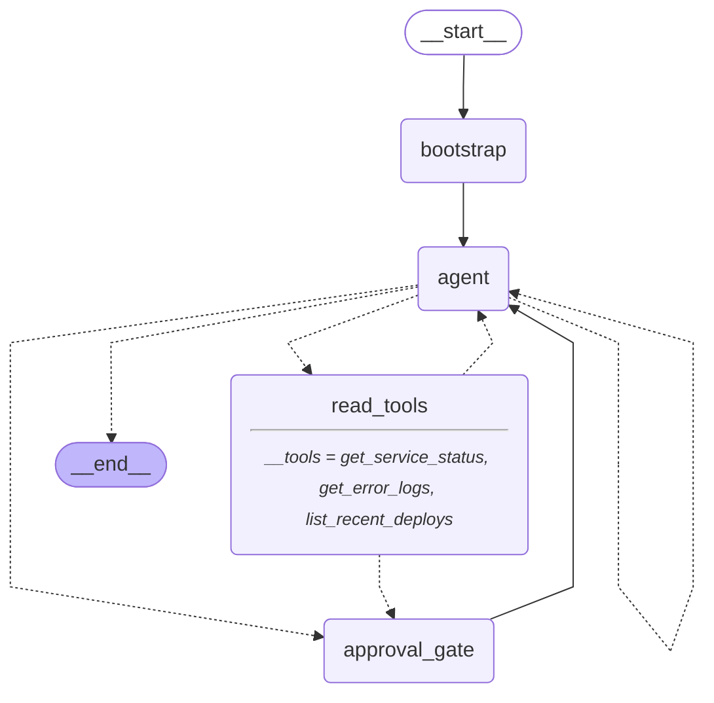

# On-call ops copilot with approved writes

> Let an on-call copilot read service health freely but run restarts, scaling and rollbacks only after a human approves, edits or rejects each one, with hard limits enforced in code even after approval.

| | |
|---|---|
| **Example id** | `ops_copilot` |
| **Category** | Human-in-the-loop & persistence |
| **Difficulty** | advanced |
| **Models** | OpenAI chat (tool calling) |
| **Data** | - |
| **LangGraph features** | interrupt with approve/edit/reject, ToolNode + Send, tool-call splitting, InjectedState, defence in depth, state-held environment, bounded agent loop |
| **Source** | [`src/deepdive/examples/ops_copilot.py`](../../src/deepdive/examples/ops_copilot.py) |

---

## Problem

An on-call engineer chats with a copilot about service health ("the api is slow and throwing 503s") and wants
it to ACT: restart a service, scale replicas, roll back a deploy. Looking is safe; changing production is not.
So every change must be shown to the engineer, who can approve it, EDIT its arguments (scale to 4, not the 10 the
model asked for) or reject it with a reason. And even an approved change must not break a hard rule (never more
than 20 replicas, never restart the database by accident), because an approval is a human clicking quickly at
3am, not a safety proof.

## Design

A small simulated environment lives in graph STATE (`env`: four services api / worker / db / cache with status,
CPU, memory, error rate, replicas and version, plus recent deploys and error logs; everything is deterministic).
Keeping it in state means a change is visible in Studio's state panel, is checkpointed with the conversation,
and is isolated per thread, so tests and parallel Studio threads never share an "environment".

Tools are split by what they can do, and the split is enforced by the graph, not by the prompt:

  * read tools (`get_service_status`, `get_error_logs`, `list_recent_deploys`) run in a prebuilt
    `ToolNode` and read `env` through `InjectedState` (the model never sees or sets that argument);
  * write tools (`restart_service`, `scale_service`, `rollback_deploy`) are declared so the model can call
    them, but their bodies raise: they are never given to the `ToolNode`. The only code that changes `env` is
    `apply_write`, reached only from `approval_gate`.

One AI message may contain both kinds of call ("show me the logs and restart the worker"). `route_after_agent`
splits the message: the read calls go to the `ToolNode` as a `Send` of just those calls, and when they have
finished the unanswered write calls go to `approval_gate`. Reads therefore run first and the engineer sees
the results while deciding. Every tool call gets exactly one matching `ToolMessage` - results, rejections,
refusals and invalid arguments included - because OpenAI rejects a history in which a tool call has no answer.

`approval_gate` works in two phases. Phase 1 asks: for each pending write it calls `interrupt()` with the
proposed call, a one-line summary, the current state of the service and a preview of the hard-limit check, and
accepts `{"action": "approve"}`, `{"action": "edit", "args": {...}}` (merged over the proposal and validated)
or `{"action": "reject", "reason": "..."}`. An invalid answer is re-asked at most 2 times, then the call is
rejected (fail closed). Phase 2 acts: only after ALL answers are in does it run anything. That ordering is the
interrupt rule in action: when a node resumes it restarts from its first line and replays earlier answers, so
a change applied between two `interrupt()` calls would be applied again on the next resume.

Defence in depth: `check_limits` is plain code that runs in phase 2 on the arguments that will actually be used
(so after an edit too), whatever the human clicked. The gate shows the same check as a preview so the engineer
knows an approval will be refused, but the preview is advisory and the phase-2 check is the one that counts.
The model is also told the limits in its prompt so it does not waste approvals; prompts are a courtesy, code is
the guarantee. The agent loop is bounded by `max_steps` (default 6 model calls per user message).

WHY A DYNAMIC `interrupt()` AND NOT A STATIC BREAKPOINT. The same behaviour is possible with a static
breakpoint in a variant of this graph where the write calls run in a plain node called `write_tools` and the
graph is compiled with `interrupt_before=["write_tools"]`. The run then stops before that node; you read the
proposal with `graph.get_state(config).values["messages"][-1].tool_calls`; to edit, you call
`graph.update_state(config, {"messages": [AIMessage(content="", id=<same id>, tool_calls=[edited])]})` (the same
id makes `add_messages` replace the message); to reject, you write `ToolMessage` answers with
`update_state(config, {...}, as_node="write_tools")` so the node is skipped; then `graph.invoke(None, config)`
continues. That works, and it is the right tool for debugging, but it is a poor approval flow: the breakpoint is
unconditional (it stops even when there is nothing to approve, unless you split nodes); the human gets raw state,
not a tailored case; an edit is state surgery with no validation; and the decision is not data the node can
reason about, so nothing can re-ask on bad input or run the limit check against what the human chose. A dynamic
`interrupt()` inside the gate asks only when there is something to approve, carries a purpose-built payload,
and keeps the decision logic in one tested function.

## Graph

```text
START -> bootstrap -> agent
agent         -> END               the message has no tool calls (the answer)
agent         -> agent             only malformed tool calls: the model tries again (bounded by max_steps)
agent         -> read_tools        the message has read calls (a Send carrying just those calls)
agent         -> approval_gate     the message has only write calls
read_tools    -> approval_gate     write calls from the same message are still unanswered
read_tools    -> agent             nothing left to approve
approval_gate -> agent             (every call now has a ToolMessage, whatever happened to it)

Two conditional edges do the splitting: ``route_after_agent`` (which may return a ``Send``) and
``route_after_reads``. ``bootstrap`` creates ``env`` once per thread and resets the step counter for each user message.
```

## LangGraph features

* `interrupt()` / `Command(resume=...)` with approve / edit / reject payloads and a re-ask loop
* the interrupt-restarts-the-node rule (ask first, act after) and its static-breakpoint equivalent (see DESIGN)
* prebuilt `ToolNode` fed by a conditional edge returning `Send` (it accepts a bare list of tool calls),
  with `InjectedState` so tools read graph state
* splitting one AI message's tool calls into read and write paths
* state-held simulated environment, an append-only `audit` list with a reducer
* a bounded agent loop (`max_steps` counter in state, reset on each user message by `bootstrap`)
* `input_schema` / `output_schema` with a `messages` key so Studio's chat view works

## Models and data

OpenAI chat with tool calling (`bind_tools`). No dataset: the environment is invented and fully contained in
`initial_env()`. SIMULATED: all of it (services, metrics, logs, deploys, the effect of each action). Offline
mode uses the deterministic stand-in model, which calls one tool whose name or description overlaps the message;
that is enough to exercise every path but is not a model of how a real model would diagnose anything. Operator
identity is not checked; a real deployment needs authentication on whoever can resume the thread.

## Try it in Studio

The graph needs a checkpointer for `interrupt()`; Studio provides one. Chat input (`messages`):
  1. "The api is slow and throwing 503s. Check it and add capacity if that is the right call." The model reads
     status and logs (no pause), then proposes `scale_service`. The run stops at `approval_gate`; open the
     interrupt. Resume with {"action": "edit", "args": {"replicas": 4}} and check the `env` in the state panel:
     api has 4 replicas, and the ToolMessage tells the model that you changed its number.
  2. "Why is the worker failing?" Reads only: the logs show a KeyError that starts with the 2026.11.4 deploy, and
     the model will usually propose `rollback_deploy` to 2026.11.2. Resume with
     {"action": "reject", "reason": "wait for the author"} and watch the model accept it instead of retrying.
  3. Hard limits. Repeat step 1 but resume with {"action": "edit", "args": {"replicas": 50}} (an operator typo):
     the tool result says REFUSED by safety limits, `env` is unchanged, and the preview in the interrupt had
     already warned you. Then ask "restart the database": the model sets `confirm` because you asked for it;
     resume with {"action": "edit", "args": {"confirm": false}} and the db rule refuses it.
  4. Ask for two things at once ("show the worker logs and restart the cache") to see the split: the read runs,
     then only the write is gated. Open the `audit` list in the output for the full trail.
Resume values for check runs: `EXAMPLE_RESUMES` in this module.

## Extend it

Add a `risk` field to each write (`low` auto-approves, `high` needs two approvers). Give `get_error_logs`
a `Command`-returning variant that summarises long logs in a subgraph. Replace the simulated `env` with
real API clients behind the same `apply_write` function: the gate and the limits stay unchanged.

## Compiled graph

Drawn from the compiled graph by `scripts/gen_docs.py` (one level of subgraphs expanded).



## Example input

```json
{
  "messages": [
    {
      "role": "user",
      "content": "The api is throwing 503s. Scale it up, it needs more capacity."
    }
  ]
}
```

Resume values (answers to the interrupts, in order):

```json
[
  {
    "action": "edit",
    "args": {
      "replicas": 4
    }
  }
]
```

Run it: `uv run langgraph dev`, open Studio, choose `ops_copilot`, paste the input above.
