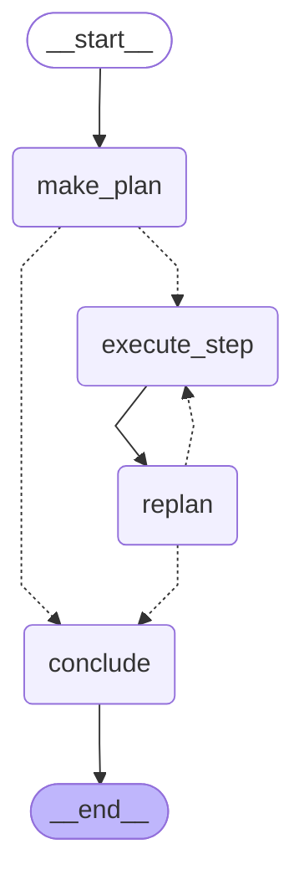

# Plan, execute, replan: analyst for multi-step questions

> Answer dependent, multi-step sales questions with exact numbers by planning against a closed tool registry, executing deterministically, replanning on observations, and stopping at a hard step budget.

| | |
|---|---|
| **Example id** | `plan_execute_analyst` |
| **Category** | Agents & tools |
| **Difficulty** | intermediate |
| **Models** | OpenAI chat |
| **Data** | `sales.csv` |
| **LangGraph features** | plan-as-state, loop with replanning and hard caps, closed tool registry, tool errors as observations, structured output |
| **Source** | [`src/deepdive/examples/plan_execute_analyst.py`](../../src/deepdive/examples/plan_execute_analyst.py) |

---

## Problem

"Did the Therm price cut on 2026-05-01 increase units enough to offset the lower price?" cannot be answered with
one query. It needs dependent steps (units before, units after, revenue before and after, then arithmetic) and a
comparison that is fair about period length. A free-roaming ReAct agent tends to wander: it repeats queries,
compares unequal periods, and does the final arithmetic in its head. Analysts need the opposite: a short plan they
can read, exact numbers from a fixed set of tools, and a clear stop.

## Design

The model writes the plan and the conclusion; code does everything in between.

  * make_plan      the LLM writes an ordered plan of at most `max_steps` steps. Every step names ONE tool from a
                   closed registry (revenue_summary, metric_by_period, compare_periods, top_n, calculate) and gives
                   its arguments as flat typed fields (a Literal tool name, a few strings, one int). There is no
                   free-form dict and no code: the model chooses arguments, never writes logic.
  * execute_step   code runs the next step through `_sales_tools` (pandas) and stores its text and numbers. A
                   step that raises (unknown product, impossible date, a reference to a step that failed) does NOT
                   crash the run: the error becomes the step's result, written for the model to read.
  * replan         after every step the LLM sees everything so far and chooses `continue` (keep the plan),
                   `revise_remaining` (replace all remaining steps, for example to correct a bad argument) or
                   `finish`. Code enforces the limits: a hard `max_steps` budget and at most two revisions.
  * conclude       the LLM writes the answer, citing step results by number: "units rose 46.9% [2]". Code checks
                   that every citation points at a step that exists and succeeded.

Arithmetic is a tool (`calculate`) that reads named numbers from earlier steps (`s2.pct_change`) and evaluates
only + - * / ** % // with the same safe evaluator as the shared calculator: no `eval`.

Why plan-then-execute and not ReAct? The plan is visible before any query runs, each step is independently
inspectable in Studio, the tool set is closed, and the budget is a number. The replanner keeps it from being rigid:
it is the only place the plan can change, and it can change only the remaining steps.

## Graph

```text
START -> make_plan --(plan has steps)--> execute_step -> replan --(continue / revise_remaining)--> execute_step
             |                                             |
             |  (empty plan)                               |  (finish, or step budget spent)
             +-----------------------> conclude <---------+
                                          |
                                         END
```

## LangGraph features

* plan-as-state: `pending` (steps still to run) and `steps` (steps run, with results) are ordinary state keys,
  so Studio shows the plan shrinking and the evidence growing, and you can edit them with update_state
* a loop with a conditional edge and explicit counters (`max_steps`, `revisions`) instead of relying on the
  recursion limit
* a closed tool registry executed by code, with tool errors turned into observations
* structured output with `Literal` fields (strict-mode friendly) for plan and decisions; input/output schemas

## Models and data

OpenAI chat model: structured output for the plan and the replan decisions, plain text for the conclusion. Data:
`sales.csv` (see `_sales_tools` for the exact metric definitions). Offline, the stand-in planner fills
arguments with placeholder text, so you will see failed steps being fed back as observations and the run still
finishing within its budget; run it live for a real analysis. Not covered: the model can still choose a poor
comparison window (the notes returned by `compare_periods` warn about unequal lengths); a human reviewer should
read the plan, which is why it is a first-class state key.

## Try it in Studio

Open the `Ready-made case` dropdown, pick one and press Submit (or leave the form blank on a new thread: that runs
the first one). Open `make_plan` to read the plan, then step through `execute_step` / `replan` and watch
`steps` fill. Each case sets the question and the step budget:
  * `Did the Therm price cut on 2026-05-01 offset the lower price?` - a sound run compares equal windows either
    side of the cut (for example Feb-Apr with May-Jul) and finds units up about 47% (32 -> 47) and revenue up about
    44%, with a caveat that summer demand may share the credit.
  * `Which region had the highest return rate for Cam Pro last quarter?` (3 steps) - APAC leads at 20%, but on
    only 10 order lines; a good conclusion says the sample is thin.
  * `Top 2 products by margin last quarter, and their share of total margin?` - a `top_n` step feeds a
    `calculate` step through named numbers (`s1.rank1`).
  * `What was customer satisfaction in Q2?` - the sales data cannot answer it; check that the conclusion says so.
  * `How did the Lumen Doorbell sell last quarter?` (2 steps) - there is no such product (it is `Lumen Bell`):
    the tool error becomes an observation, and the replanner can fix the step within the budget.
  * `Break down 2026 revenue by region, channel and product` (2 steps) - needs more steps than the budget; watch
    the plan being cut and `stop_reason` become `max_steps`.
To ask your own, paste `{"question": "Did the Therm price cut on 2026-05-01 increase units enough to offset the
lower price?", "max_steps": 6}`.

## Extend it

Add a tool that reads `product_reviews.csv` so the analyst can look at sentiment around the price cut. Add an
`interrupt()` after `make_plan` so a person approves the plan before anything runs. Let `replan` use a
Decisions API `predicate` ("do the results already answer the question?") instead of a free-text decision.

## Compiled graph

Drawn from the compiled graph by `scripts/gen_docs.py` (one level of subgraphs expanded).



## Ready-made cases in Studio

The input form has a **Ready-made case** dropdown, so you do not need to know the data. Pick one and press Submit; a blank form on a new thread runs the first.

| # | Case (as shown in the dropdown) | Input it stands for |
|---|---|---|
| 1 | Did the Therm price cut on 2026-05-01 offset the lower price? -> Feb-Apr vs May-Jul: units 32 -> 47, revenue +44% | `{"question": "Did the Therm price cut on 2026-05-01 increase units enough to offset the lower price?"}` |
| 2 | Which region had the highest return rate for Cam Pro last quarter? (3 steps) -> APAC 20% on just 10 lines: thin sample | `{"question": "Which region had the highest return rate for Cam Pro last quarter?", "max_steps": 3}` |
| 3 | Top 2 products by margin last quarter, and their share of total margin? -> Therm and Hub: watch top_n feed calculate | `{"question": "Which two products had the highest margin last quarter, and what share of total margin do they make up?"}` |
| 4 | What was customer satisfaction in Q2? -> the sales data has no such field: does the conclusion say so? | `{"question": "What was customer satisfaction in Q2?"}` |
| 5 | How did the Lumen Doorbell sell last quarter? (2 steps) -> no such product ('Lumen Bell'): watch the error and replan | `{"question": "How did the Lumen Doorbell sell last quarter?", "max_steps": 2}` |
| 6 | Break down 2026 revenue by region, channel and product (2 steps) -> needs 3 steps: watch the budget cut it short | `{"question": "Break down 2026 revenue by region, by channel and by product, and tell me which of the three is the weakest.", "max_steps": 2}` |

## Example input

```json
{
  "question": "Did the Therm price cut on 2026-05-01 increase units enough to offset the lower price?"
}
```

Run it: `uv run langgraph dev`, open Studio, choose `plan_execute_analyst`, pick a case from the **Ready-made case** dropdown, or paste the input above.
