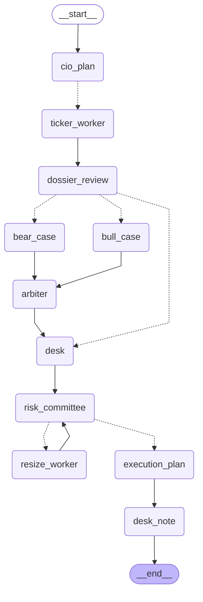

# Portfolio desk (lite): parallel research, debate, risk committee, execution

> Turn eight fictional stocks into one risk-checked daily trade blotter: research every name in parallel, hear a bull and a bear case, let a risk committee send only the breaching names back for resizing, and plan the execution, with code guaranteeing the limits.

| | |
|---|---|
| **Example id** | `portfolio_desk_lite` |
| **Category** | Multi-agent |
| **Difficulty** | advanced |
| **Models** | OpenAI chat, OpenAI Decisions API |
| **Data** | `prices.csv`, `news_headlines.csv`, `companies.csv` |
| **LangGraph features** | Send map-reduce, custom keyed reducer, Command fan-out / skip, parallel branches + join, selective re-dispatch loop (Send from a conditional edge), loop cap in state, input/output schemas, RetryPolicy |
| **Source** | [`src/deepdive/examples/portfolio_desk_lite.py`](../../src/deepdive/examples/portfolio_desk_lite.py) |

---

## Problem

A small PM wants a daily trade blotter across eight stocks. Doing it by hand is slow and inconsistent. Handing it
to one big prompt is worse: a model that writes position sizes can write sizes that break the risk limits, and a
model that writes the closing note can quote a figure that is not in the blotter. The stakes are the ones a real
desk has: a blotter that breaches a limit must never go out, and a note must never invent a number. So one graph
needs model judgement (what to look at, how to argue both sides, how deep to cut a position) AND code guarantees
(limits, arithmetic, verification). This is the architecture of a 24-node hedge-fund graph cut down to 11 nodes
that run offline on the bundled data.

## Design

Who decides what:

  node            model judgement                       code (the guarantees)
  --------------  ------------------------------------  ---------------------------------------------------
  cio_plan        which 3-5 names, what gross budget    validates tickers against companies.csv, clamps the
                                                        budget, falls back to a rule if the model returns junk
  ticker_worker   (Decisions API) setup, direction,      every indicator: 5d and 20d return, 20d volatility,
                  conviction probabilities              RSI14, drawdown from the 60d high, z-score vs the
                                                        50d mean, 20d average volume; the setup gate
  bull_case,      the two arguments                     drops ideas about tickers that are not on the desk
  bear_case
  arbiter         (Decisions API) tilt, tail risk,      the tail-risk override; a refused tilt fails safe
                  rigor of each case
  desk            -                                     applies the tilt, sizes: conviction x side weight /
                                                        volatility, scaled to the gross budget
  risk_committee  -                                     every limit check, which names breach, the loop counter
  resize_worker   how deep to cut one position          bounds the cut, applies it, rounds down to $100
  execution_plan  -                                     shares, child orders, participation cap, cost in bps
  desk_note       the prose                             audits every number in the prose against the blotter

Four decisions shape the graph.

1. The limits are code, and the desk is deliberately not limit-aware. The desk sizes to the gross budget the way a
   PM would; the committee is the independent check (separation of duties). Concentrated books therefore breach
   naturally: if the only actionable names are three technology stocks, a NET_LONG tilt at a 45% budget puts all
   45% of NAV into one sector group against a 35% limit. The limits: one name <= 15% of NAV; one sector group
   <= 35% of NAV; gross <= the budget scaled by the tilt; no SHORT in a name that research marked AVOID (the desk
   never opens one, and the committee checks anyway, because limits must not depend on upstream code being
   right). About "sector group": every company in companies.csv sits in a different sector, so a literal
   one-sector cap could never bind. The cap is applied to groups of sectors instead: technology (industrial
   tech, semiconductors, software), cyclicals (energy, renewables, financials) and defensives (healthcare,
   consumer staples).

2. Breaches go back SELECTIVELY. The committee names only the tickers involved in a breach (one oversized name, or
   every member of an over-full group) and sends exactly those to `resize_worker` with `Send`. Names that are
   fine are not touched or recomputed. A resize worker is a model call: it sees the breach, REQUIRED_SCALE (the
   largest scale that cures every limit the name is in) and MIN_SCALE (the desk never cuts more than twice what
   the limit requires) and proposes a scale. Code bounds the proposal to [MIN_SCALE, 1.0]; a model that under-cuts
   just gets another round. A position the rules forbid (a SHORT in an AVOID name) is dropped by rule, without
   asking the model.

3. The loop provably ends. `revision_count` goes up each time the committee dispatches resizes, and it only
   dispatches while `revision_count < max_revisions`. At the cap the committee trims every breaching name itself
   with the same cure scales and sets `cap_forced`. One trim always gives a clean book: each name is scaled by
   the minimum, over the breaches it is in, of limit/actual (0 for a forbidden short); that satisfies its own cap,
   its group's cap and the gross cap together, and scaling down never raises any other figure. So there are at
   most `max_revisions` resize rounds plus one trim (the input is clamped to 0..5). `execution_plan` re-runs
   the limit check on the final share counts and refuses to build a blotter that fails it.

4. Calibrated probabilities where they are the right tool: two kinds of Decisions API gate, each ONE call with
   several questions. Per name: `setup_supportive` is a gate (below 40% a LONG or SHORT pick becomes AVOID),
   `direction` picks the side, `conviction` scales the size. For the debate: `tilt` picks the book's tilt,
   `tail_risk_elevated` at 70% or more moves it one notch toward DEFENSIVE (never the other way), and
   `bull_rigor` / `bear_rigor` grade the two arguments for you to read (they do not move money). A refused
   answer fails safe (AVOID, DEFENSIVE). If research finds nothing actionable, the debate and the arbiter are
   skipped. The desk note is written by a chat model, but code extracts every number from it and compares it with
   the blotter facts; an unsupported number replaces the note with a template and lists the offending numbers.

## Graph

```text
START -> cio_plan
            |  Send x N  (one per chosen name)
            v
        ticker_worker x N     analytics + one Decisions call each; merge_by_ticker reducer
            |
            v
        dossier_review ------ nothing actionable ---------------------------------------+
            |  Command(goto=[...])                                                       |
      +-----+-----+                                                                      |
      v           v                                                                      |
  bull_case   bear_case     (in parallel)                                                |
      +-----+-----+                                                                      |
            v  join: wait for both                                                       |
         arbiter            one Decisions call: tilt, tail risk, rigor                   |
            |                                                                            |
            v                                                                            |
          desk <-------------------------------------------------------------------------+
            |
            v
    +-> risk_committee ---- no breach, or revision cap reached ----> execution_plan
    |       |  Send x k  (ONLY the breaching names)                         |
    |       v                                                               v
    +--- resize_worker x k                                         desk_note -> END
```

## LangGraph features

* `Send` map-reduce from `cio_plan`: one `ticker_worker` per chosen name, a number only known at run time.
  Results merge through a custom reducer, `merge_by_ticker`: a list of keyed records, so state stays
  JSON-serialisable and the merge does not depend on which worker finishes first. The reducer never forgets a
  ticker, so `cio_plan` starts each run with `Overwrite([])` on every accumulating channel (Studio reuses the thread).
* `Command(goto=[...])` in `dossier_review`: start two branches at once, or skip them.
* parallel branches with an explicit join, `add_edge(["bull_case", "bear_case"], "arbiter")`.
* `Send` from a conditional edge for selective re-dispatch, wired back into `risk_committee`: a cycle that
  re-runs only the breaching names, bounded by a counter in state (DESIGN 3).
* `input_schema` / `output_schema`: Studio shows a ready-made-case dropdown, three input fields and a result
  without the internals.
* `RetryPolicy` on the two nodes that call the Decisions API: a transient network error is retried in place
  instead of failing the whole run.

## Models and data

OpenAI chat (structured output for the CIO, the two cases and the resize proposal; plain text for the desk note)
and the OpenAI Decisions API (one call per ticker, one for the arbiter). Data: `prices.csv` (160 days of OHLCV,
to 2026-10-30), `news_headlines.csv` (the sentiment labels are NOT shown to any model) and `companies.csv`.
Without an `OPENAI_API_KEY` the chat stand-in returns placeholder text and the Decisions stand-in returns
arbitrary but stable answers, so the CIO always takes its deterministic fallback and the desk note is a
placeholder. The result carries `mode`: "live" or "offline".

## Try it in Studio

Pick a ready-made case from the "Ready-made case" dropdown and press Submit (a blank form on a new thread runs
the first one). Which names trade, and whether the committee has anything to send back, depends on the models, so
the labels say what to look at rather than what will happen:
  * the standard run (the first case) and the revision-loop walkthrough: watch `risk_committee` send back only the
    names that breach a limit;
  * "technology": ACMR, CBLT and FTHM share one 35% sector-group cap, so if all three trade the whole group goes back;
  * `max_revisions` 0: nothing is ever sent back (`resize_log` stays empty), and a breach is trimmed in place;
  * a $2 billion mandate (hundreds of child orders, higher cost) and a $2 million one (a handful of orders);
  * a hint naming TSLA and NVDA, which are not in `companies.csv`: they never reach research;
  * no hint at all: the CIO model chooses the names (`mandate.source` says who chose).
Or paste an input (this one is `EXAMPLE_INPUT`, the first case; it names stocks with clear trends, because the
setup gate rightly stands aside when the picture is mixed and a no-trade day shows none of the machinery):
    {"focus_hint": "Look at ACMR, BORE, GRNT, HELO and CBLT today", "nav_usd": 10000000, "max_revisions": 2}
With an API key, one development run of this input went as follows (model output varies from run to run). The gate
rated ACMR, HELO and CBLT as AVOID and BORE as SHORT (72%, setup 78%). The debate ran and the bear case won, so the
tilt was DEFENSIVE. The desk sized BORE at 21% of NAV against the 15% limit; the committee sent ONLY BORE back, the
PM model proposed a scale of 0.55 (inside the allowed band) and pass 2 was clean. Offline the same input trades only
GRNT, so the numbered walkthrough below uses `OFFLINE_WALKTHROUGH_INPUT` instead, which the tests verify:
    {"focus_hint": "Look at GRNT, DLPH, ACMR and FTHM today", "nav_usd": 10000000, "max_revisions": 2}
Open the run and read it step by step:
  * `mandate` (cio_plan): `source` says who chose the names. Offline the stand-in model returns placeholder
    tickers, so `source` is "fallback" and the names come from the hint (tickers, company names, sectors or
    group names all count); with a key the CIO model reads the hint and `source` is "model".
  * `dossiers` (parallel ticker_worker runs, one per focus name): the indicators, the headlines the model saw, and the
    Decisions probabilities: `p_setup`, `direction_probs`, `conviction_probs`. `gated` is true when the
    setup gate overrode a LONG/SHORT pick.
  * `verdict` (arbiter): the tilt and its probabilities, `tail_risk_p`, the rigor grade of each case, and who
    won the debate. `bull_argument` / `bear_argument` hold the two cases.
  * `risk_history` and `resize_log` (risk_committee, resize_worker): offline, with
    `OFFLINE_WALKTHROUGH_INPUT`, two names are actionable (DLPH and GRNT) and the tilt is DEFENSIVE. The desk sizes DLPH at 15.7% of NAV against the 15% limit and GRNT at
    14.3%, so ONLY DLPH is sent back (REQUIRED_SCALE 0.9533, MIN_SCALE 0.9066) and GRNT is never touched. Pass 2
    finds no breach and the loop ends. The stand-in PM proposes 0.5, which MIN_SCALE lifts to 0.9066.
  * `blotter` (execution_plan): shares, notional, % of NAV, child-order count and estimated cost per name, then
    totals; `execution` has the child orders themselves. `note` is the desk note and whether it passed the
    number audit.
Then change the walkthrough input:
  * `"max_revisions": 0`: the committee may not send anything back, trims DLPH itself, and `cap_forced` is
    true (look at `risk_history[0].action` = "trim" and the row's status "trimmed").
  * `"nav_usd": 2000000000`: the same weights, but each order is about 85-90% of a whole day's average volume,
    so the participation cap forces over 200 child orders spread over 17-19 sessions and the estimated cost rises
    from about 7 bps to about 78 bps.
  * with an API key, `"focus_hint": "technology"`: if three technology names turn out actionable, a NET_LONG or
    NEUTRAL tilt can put the group above 35%, and then the committee sends back every member of the group, not
    just one name.

## Extend it

Add a short-borrow limit (a fifth check in `_desk_math.check_limits` plus its cure scale), replace the 13 equal
half-hour slots with a volume curve, or add a human approval of the blotter with `interrupt()` before
`execution_plan` (that needs a checkpointer, which Studio provides).

## Limits

The market is synthetic and the cost model is a textbook square-root impact with an uncalibrated coefficient.
There are no borrow costs, no intraday data, no corporate actions, and no order is ever sent anywhere. Headlines
are untrusted text that models read; here they are synthetic, but a real feed would need injection hardening.
A production desk would also persist every committee pass for audit and version its prompts.

## Compiled graph

Drawn from the compiled graph by `scripts/gen_docs.py` (one level of subgraphs expanded).



## Ready-made cases in Studio

The input form has a **Ready-made case** dropdown, so you do not need to know the data. Pick one and press Submit; a blank form on a new thread runs the first.

| # | Case (as shown in the dropdown) | Input it stands for |
|---|---|---|
| 1 | ACMR, BORE, GRNT, HELO, CBLT at $10M, 2 rounds -> the standard run: watch for names the risk committee sends back | `{"focus_hint": "Look at ACMR, BORE, GRNT, HELO and CBLT today", "nav_usd": 10000000, "max_revisions": 2}` |
| 2 | GRNT, DLPH, ACMR, FTHM at $10M, 2 rounds -> revision loop: watch only a name over a limit go back (resize_log) | `{"focus_hint": "Look at GRNT, DLPH, ACMR and FTHM today", "nav_usd": 10000000, "max_revisions": 2}` |
| 3 | Hint 'technology' (ACMR, CBLT, FTHM share one 35% cap) -> if all three trade, watch the whole group go back | `{"focus_hint": "technology", "nav_usd": 10000000, "max_revisions": 2}` |
| 4 | GRNT, DLPH, ACMR, FTHM with max_revisions 0 -> nothing is sent back (resize_log empty); a breach is trimmed | `{"focus_hint": "Look at GRNT, DLPH, ACMR and FTHM today", "nav_usd": 10000000, "max_revisions": 0}` |
| 5 | GRNT, DLPH, ACMR, FTHM at $2 billion -> watch for hundreds of child orders over several sessions, higher bps | `{"focus_hint": "Look at GRNT, DLPH, ACMR and FTHM today", "nav_usd": 2000000000, "max_revisions": 2}` |
| 6 | Defensives (DLPH, EMBR) at $2M -> a small mandate: watch for few child orders and a lower cost in bps | `{"focus_hint": "defensive names: DLPH and EMBR", "nav_usd": 2000000, "max_revisions": 2}` |
| 7 | TSLA, NVDA and ACMR, but only ACMR is in the data -> TSLA and NVDA never reach research (mandate) | `{"focus_hint": "Look at TSLA, NVDA and ACMR today", "nav_usd": 10000000, "max_revisions": 2}` |
| 8 | No hint, $10M -> the CIO model picks the names from the table: watch mandate.source and rationale | `{"nav_usd": 10000000, "max_revisions": 2}` |

## Example input

```json
{
  "focus_hint": "Look at ACMR, BORE, GRNT, HELO and CBLT today",
  "nav_usd": 10000000,
  "max_revisions": 2
}
```

Run it: `uv run langgraph dev`, open Studio, choose `portfolio_desk_lite`, pick a case from the **Ready-made case** dropdown, or paste the input above.
