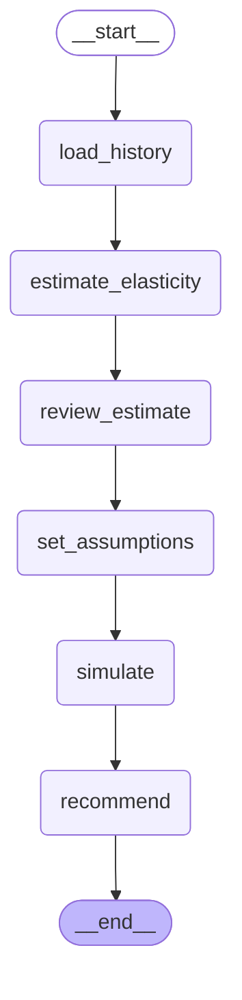

# Pricing what-if: fork a saved run with time travel

> Let a pricing manager change one assumption in a finished analysis and recompute only the dependent steps by forking the saved run at its assumptions checkpoint, without losing the original.

| | |
|---|---|
| **Example id** | `pricing_whatif` |
| **Category** | Human-in-the-loop & persistence |
| **Difficulty** | advanced |
| **Models** | OpenAI chat |
| **Data** | `sales.csv` |
| **LangGraph features** | checkpoints, get_state_history, update_state forking, replay without re-running earlier nodes, branching histories |
| **Source** | [`src/deepdive/examples/pricing_whatif.py`](../../src/deepdive/examples/pricing_whatif.py) |

---

## Problem

A pricing manager reads the analysis for a product and asks "what if we had targeted a 35% margin instead of
28%?". Then "and if demand is less price-sensitive than you estimated?". Re-running the whole analysis for each
question repeats the slow, costly part - loading and aggregating sales, fitting a demand model with a bootstrap,
and an LLM review of the fit - to change one number that only the last two steps use. We want to FORK the saved
run at the point where the assumptions were fixed, edit them, and recompute only the steps downstream, keeping
the original run intact for comparison.

## Design

The graph is cut so that the question "what depends on what" is visible in the topology:

  * `load_history` (data) and `estimate_elasticity` (numpy) are deterministic and upstream of everything.
    Elasticity is the slope of a log-log regression of weekly units on the weekly average selling price, with
    a seeded bootstrap (500 resamples of weeks, 5th-95th percentile) for an interval, so the same data always
    gives the same numbers. `review_estimate` (LLM) turns the fit into three plain sentences about how far to
    trust it. This is the expensive, reusable part.
  * `set_assumptions` is deliberately its own node and is THE fork point (a node cannot share a name with a
    state key, so the node is `set_assumptions` and the dict it writes is `assumptions`). It holds
    every number the rest of the graph is allowed to use: unit cost from the data, variable cost rate, margin
    target, elasticity (and its interval), baseline price and weekly units, horizon, candidate prices.
    Everything downstream reads ONLY this dict (`recommend` takes the margin target from it, not from the
    input), so editing it is a complete, honest what-if. Edit `margin_target`, `elasticity` or
    `variable_cost_rate`; do not edit values the data produced unless you mean to override them.
  * `simulate` (code) projects a 13-week horizon for each candidate price with a constant-elasticity demand
    curve: expected units, revenue, contribution margin, margin %, a units interval from the elasticity
    interval, and flags for "meets the margin target" and "inside the price range the data supports".
  * `recommend` picks the winner in CODE: the candidate that maximises total contribution margin among those
    that meet the margin target and are within 10% of the weekly prices actually observed. The model only
    writes the paragraph, and a check requires the paragraph to quote the chosen price, margin and contribution
    exactly as the table has them; if it does not, a fixed template is used instead, so no number in the output
    comes from a language model.

Margin here is CONTRIBUTION margin: (price x (1 - variable_cost_rate) - unit_cost) / price. The dataset has unit
cost but not payment fees, shipping or returns, so `variable_cost_rate` (default 22%) is an assumption that
finance should own; it is why the default 28% target roughly equals today's margin for Lumen Therm and 35% is a
real change. Because demand here is more elastic than -1 and the margin target is a FLOOR, profit keeps rising as
the price falls until the floor binds, so the answer is "the lowest candidate price that still meets the floor";
the interesting output is how far that price moves and what it does to units.

WHAT TIME TRAVEL GIVES YOU HERE. Every super-step is a checkpoint. `get_state_history` lists them; each has a
`next` field. The checkpoint whose `next` is `("simulate",)` is the state right after `set_assumptions`.
`graph.update_state(that_checkpoint, {"assumptions": edited})` writes a NEW checkpoint (a child of that one)
and returns its config; `graph.invoke(None, fork_config)` then runs only the nodes after it. Nothing is
overwritten: checkpoints are immutable, the original final checkpoint stays reachable by its
`checkpoint_id`, and the thread's "latest" now follows the fork. `scripts/time_travel_demo.py` does exactly
this and prints both outcomes side by side.

## Graph

```text
START -> load_history -> estimate_elasticity -> review_estimate -> set_assumptions -> simulate -> recommend -> END
         (data)          (numpy, seeded)         (LLM, 1 call)       (code)             (code)     (code + 1 LLM call)
                                                                 writes `assumptions`
                                                                 = THE FORK POINT
                                                                 (checkpoint with next=("simulate",))
```

## LangGraph features

* checkpoints and `get_state_history`: the run is a list of states you can inspect
* `update_state` on a past checkpoint = forking; `invoke(None, fork_config)` = continuing from it
* replay semantics: nodes before the chosen checkpoint are NOT re-run (the tests count executions)
* branching histories in one thread, original branch preserved
* `input_schema` / `output_schema` so Studio shows a clean form and result

## Models and data

OpenAI chat twice (`review_estimate` and the paragraph in `recommend`); everything else is numpy/pandas on
`data/sales.csv` (cancelled orders excluded). Honest limits: Lumen Therm has 44 weeks with sales and 1 to 11
units per week, so the elasticity is noisy (about -4.8 with a 90% interval from roughly -8 to -2, R-squared about
0.17). Weeks with no sales are left out of the fit, a log-log fit on small counts is crude (a Poisson model would be
better), prices move together with seasonality, and a constant elasticity extrapolated 20% from observed prices
is a guess. The recommendation says so when it leaves the observed range. This is a demonstration of forking,
not a pricing engine.

## Try it in Studio

1. Pick a case from the "Ready-made case" dropdown and press Submit (on a new thread a blank form runs the first
   one). Each case is a product from `sales.csv` and, for some, a margin floor; the recommendation is chosen in
   code from seeded numbers, so these results repeat exactly:
     * Lumen Therm, default 28% floor: about $145 (its list price is now $149).
     * Lumen Therm, 35% floor: $170 with an extrapolation warning, because no week ever averaged above $159.
     * Lumen Therm, 45% floor: "no feasible price".
     * Lumen Cam Pro, default 28% floor: $80.
     * Lumen Sensor Kit, default floor: price barely moves its demand (elasticity -0.24, R-squared 0.00), so the
       analysis pushes the price up to $60, an extrapolation: a fit with no signal gives a weak recommendation.
   Read `assumptions` and the `recommendation` of the run.
2. Open the thread's history, select the `set_assumptions` step (the last checkpoint before `simulate`),
   edit the `assumptions` value in the state panel - set `"margin_target": 0.35` - and fork / re-run from that
   step. (Button names differ a little between Studio versions; what matters is that you edit state at that
   checkpoint and continue from it.) Only `simulate` and `recommend` run again; for Lumen Therm the new
   recommendation is about $170 and carries an extrapolation warning, as in the second case above.
3. Select the original run's final step: it is unchanged. Try `"elasticity": -3` for a less price-sensitive
   market, or `"margin_target": 0.45` to see the "no feasible price" answer.
4. By hand: `{"product": "Lumen Therm", "margin_target": 0.28}` (both fields are optional), or any of the eight
   products. Same thing in code: `.venv/bin/python scripts/time_travel_demo.py` (add `--margin 0.30` for
   another what-if).

## Extend it

Fork twice from the same checkpoint (two scenarios) and diff them. Add a second fork point after
`estimate_elasticity` to let the manager override the demand model. Replace the single-product log-log fit with
a Decisions-API-graded set of price-sensitivity cues from reviews, kept upstream of `assumptions`.

## Compiled graph

Drawn from the compiled graph by `scripts/gen_docs.py` (one level of subgraphs expanded).



## Ready-made cases in Studio

The input form has a **Ready-made case** dropdown, so you do not need to know the data. Pick one and press Submit; a blank form on a new thread runs the first.

| # | Case (as shown in the dropdown) | Input it stands for |
|---|---|---|
| 1 | Lumen Therm, default 28% margin floor -> recommends $145 (its list price is now $149) | `{"product": "Lumen Therm"}` |
| 2 | Lumen Therm, 35% margin floor -> recommends $170, an extrapolation (no week ever averaged above $159) | `{"product": "Lumen Therm", "margin_target": 0.35}` |
| 3 | Lumen Therm, 45% margin floor -> no feasible price: nothing in the supported range meets it | `{"product": "Lumen Therm", "margin_target": 0.45}` |
| 4 | Lumen Cam Pro (unit cost $38, list price $89), default 28% margin floor -> recommends $80 | `{"product": "Lumen Cam Pro"}` |
| 5 | Lumen Sensor Kit, price barely moves demand (elasticity -0.24, R-squared 0.00) -> $60, an extrapolation | `{"product": "Lumen Sensor Kit"}` |

## Example input

```json
{
  "product": "Lumen Therm"
}
```

Run it: `uv run langgraph dev`, open Studio, choose `pricing_whatif`, pick a case from the **Ready-made case** dropdown, or paste the input above.
