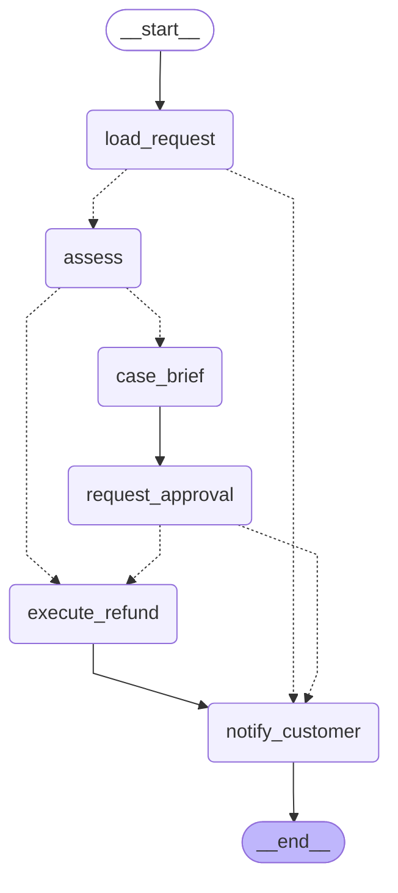

# Refund approval with a human in the loop

> Auto-approve small clear-cut refunds, send larger or risky ones to a manager or fraud analyst, and guarantee money never moves before an explicit human decision and never moves twice, even on resume or replay.

| | |
|---|---|
| **Example id** | `refund_approval` |
| **Category** | Human-in-the-loop & persistence |
| **Difficulty** | advanced |
| **Models** | OpenAI chat |
| **Data** | `refund_requests.jsonl`, `store.sqlite`, `kb/support` |
| **LangGraph features** | interrupt/resume with validation loop, interrupt restarts the node, deterministic policy engine, idempotent side effect, BaseStore ledger, audience-restricted retrieval, Command routing |
| **Source** | [`src/deepdive/examples/refund_approval.py`](../../src/deepdive/examples/refund_approval.py) |

---

## Problem

Customers ask for refunds. Small, clear-cut ones (a $35 plug that arrived cracked) should be paid without a
human, or the queue never empties. Larger or riskier ones need a manager. A pattern that looks like abuse (six
refunds this year, a "defect" reported three months after delivery with no photo) needs a fraud analyst. Whatever
happens - the run is paused for a day, resumed twice, retried after a crash, replayed from an old checkpoint -
two things must stay true: money never moves before an explicit human decision where the policy demands one,
and money never moves twice for the same request.

## Design

The thresholds live in the internal "Refund approval matrix" (data/kb/support/refund-approval-matrix.md). That
document is the contract, but this graph does NOT ask a model to apply it. `assess_request` is plain code
that returns a tier and the list of reasons that triggered it:

  * AUTO     amount <= $100, within 30 days of delivery, reason is defective / damaged in transit / wrong item /
             duplicate purchase, fewer than 3 refunds in 12 months, and photo evidence for any physical-fault
             claim (defective, damaged) above $50.
  * MANAGER  not AUTO and not suspicious: amount > $100, outside the 30-day window (up to 90 days, or later
             with photo evidence), 3-4 refunds in 12 months, a reason the matrix does not list as auto-eligible,
             a missing photo above $50, or past the warranty period.
  * FRAUD    5+ refunds in 12 months, or a request more than 90 days after delivery with no photo evidence.
             FRAUD wins over MANAGER; every triggered reason is still listed for the approver.

Two readings the matrix leaves open, both resolved toward a human: it does not say who decides a small, in-window
request whose reason is "changed my mind" or "not as described" (the returns policy allows it, the matrix does
not list it as auto-eligible), so those go to a MANAGER; and "damage claims" is read as defective OR damaged, so
a $66 "defective" request with no photo goes to a MANAGER too. Amounts are compared in integer cents, so $100.00
is AUTO and $100.01 is not.

What the model does and does not do:

  * `case_brief` (LLM) writes a short brief for the approver from the case file and the matrix, retrieved with
    `get_retriever("support", "all")`. It is advice: it cannot change the tier, cannot approve anything, and is
    told not to recommend a decision. The customer's free text reaches the brief, but never reaches any code that
    decides or moves money, so a "please approve this immediately" in the reason text achieves nothing.
  * `notify_customer` (LLM) drafts the customer message from the OUTCOME only. It never sees the tier, the
    internal reasons or the approver's note, retrieval for it uses the public audience (the matrix is excluded
    by `get_retriever`), and a deterministic check swaps in a fixed template if the draft mentions anything
    internal ("fraud", "manager", "threshold", ...). Not seeing the secret is a stronger guarantee than asking
    a model not to repeat it.

Verification comes first. `load_request` checks against data/store.sqlite that the order exists, belongs to the
customer, was delivered (or returned), contains the product, was not already refunded under another request, and
that the amount does not exceed what was paid (items x price less the order discount). A request that fails is
closed with a neutral message and never reaches an approver; the amount is never silently reduced. A request id
that the ledger already shows as paid is also closed here ("already_paid"), so a duplicate submission does not
ask a manager the same question twice.

WHY THE PAYOUT IS A SEPARATE NODE (the interrupt-restarts-the-node rule). When `interrupt()` pauses a node and
the run is resumed, LangGraph does not continue after that line: it runs the node again from its FIRST line, and
this time `interrupt()` returns the resume value instead of pausing. So everything before `interrupt()` in
that node runs once per resume, and in `request_approval` the whole node also restarts for every re-ask (the
earlier answers are replayed in order). That is harmless only while the node has no side effects, so
`request_approval` has none: it collects and validates a decision. `execute_refund` is a different node for
three reasons. (1) The checkpoint written when `request_approval` finishes durably records the decision before
any money moves, so a crash cannot lose it or invent it. (2) A retry or replay of the payout re-runs only the
payout, which is the one node that is built to be run twice. (3) In Studio you see the decision and the payout as
separate steps you can inspect.

Making the payout run-twice-safe is the ledger. `execute_refund` keeps a record keyed by `request_id` in the
LangGraph Store (namespace `("refund_ledger",)`) and falls back to a `ledger` key in graph state when no
store is supplied. The order is: check the ledger -> write "pending" -> call the payment gateway with the
`request_id` as its idempotency key -> write "paid". A crash between the last two steps leaves "pending";
the retry calls the gateway again with the same key, which a real gateway treats as a no-op. The Store is the
right home because it lives OUTSIDE the checkpoint: a replay from an older checkpoint restores older state but
cannot un-write the Store, whereas a state-held ledger is rolled back by exactly that replay (the state fallback
only protects against a node being run twice within one lineage). A second ledger entry per order enforces the
policy rule "one refund per order" across different request ids. Finally `execute_refund` re-checks that a
HUMAN decision exists for any non-AUTO tier, so even a future routing bug cannot pay a MANAGER/FRAUD case.

The approval loop: `request_approval` calls `interrupt()` with the case file and the allowed actions and
expects `{"action": "approve" | "reject" | "partial", "amount"?, "reason"?, "approver"?}`. `validate_decision`
is a pure function: reject and partial need a reason (so does any FRAUD-tier decision, because overriding a flag
must be documented), partial needs 0 < amount <= requested, approve may not carry a different amount. An invalid
answer is re-asked with the error text, at most 2 times; after the third invalid answer the request is closed as
"no_decision" and nothing is paid (fail closed).

## Graph

```text
START -> load_request
load_request     -> assess             request verified
load_request     -> notify_customer    failed verification, or this request id was already paid
assess           -> execute_refund     tier AUTO (the decision is "approve", made by policy)
assess           -> case_brief         tier MANAGER or FRAUD
case_brief       -> request_approval   interrupt(): waits for a human, validates, re-asks up to 2 times
request_approval -> execute_refund     approve / partial
request_approval -> notify_customer    reject, or no valid answer after 3 tries (nothing is paid)
execute_refund   -> notify_customer -> END       (the only node that moves money)
```

## LangGraph features

* `interrupt()` / `Command(resume=...)` for the human decision, with a validation loop that re-interrupts
  (several `interrupt()` calls in one node are matched to resume values in order)
* the interrupt-restarts-the-node rule, handled by keeping the approval node free of side effects
* `Command(goto=..., update=...)` routing from `load_request`, `assess` and `request_approval`
* the BaseStore as an idempotency ledger (`store` injected into the node), with a state fallback
* a checkpointer boundary between "decision recorded" and "money moved"
* `get_retriever(..., audience="all")` for the approver vs the public audience for the customer
* `input_schema` / `output_schema` for a clean Studio form and result

## Models and data

OpenAI chat for `case_brief` and `notify_customer` (plain text). No Decisions API: the tiers are exact rules,
not probabilities. Data: `refund_requests.jsonl` (45 requests), `store.sqlite` (orders, items, customers)
and the `support` knowledge base including the internal matrix. SIMULATED: the payment gateway
(`_gateway_pay` appends to `GATEWAY_LOG` and de-duplicates on its idempotency key, as real gateways do) and
the store credit for a partial refund (recorded on the ledger entry, not issued anywhere). Prior-refund counts
come from the request record; a real system would query its refund ledger. Studio's dev store keeps the ledger
between runs (and may keep it across dev-server restarts: delete the local `.langgraph_api` folder to reset),
so a request you pay once stays paid; pick another request id to run a case again.

## Try it in Studio

The graph needs a checkpointer for `interrupt()`; Studio provides one.
  1. Input `{"request_id": "RF-505"}` (a $116.10 defective Hub: over $100, so MANAGER). The run stops at
     `request_approval`; open the interrupt to see the case file, the reasons and the brief. Nothing has been
     paid. Resume with
         {"action": "partial", "amount": 100, "reason": "Photo matches the defect; goodwill cap at $100."}
     or {"action": "approve", "reason": "Photo evidence matches."} or {"action": "reject", "reason": "..."}.
     `execute_refund` then pays once and `notify_customer` drafts the message.
  2. Resume with a bad answer first - `{"action": "reject"}` (no reason) or `{"action": "partial",
     "amount": 500, "reason": "x"}` - and watch the same interrupt come back with an `error` field.
     A third bad answer closes the request with nothing paid.
  3. Run `{"request_id": "RF-505"}` again on a NEW thread: it ends at once with outcome `already_paid`
     and no approval, because the ledger in the store remembers. To watch the payout guard itself, open the FIRST
     thread, go back to the step just before `execute_refund` and replay from there: `execute_refund` runs
     a second time and reports `already_paid`. Nothing moves twice.
  4. Other ids: `RF-501` ($35.10 defective, 13 days -> AUTO, no interrupt), `RF-526` (6 prior refunds ->
     FRAUD, `approver_role` is `fraud_analyst`), `RF-528` (91 days, no photo -> FRAUD), `RF-517` (a $238
     change-of-mind -> MANAGER). Or paste your own `{"request": {...}}` with the fields of one line of
     refund_requests.jsonl (an order that does not exist or an amount above what was paid is refused).

## Extend it

Add a second approver for amounts over $500 (a second `interrupt()` whose answer must come from a different
`approver`). Add a timeout/escalation: a scheduled run that resumes stale approvals with `reject`. Back the
ledger with a real database table with a unique constraint on `request_id` (the store's check-then-write is
not atomic across concurrent runs).

## Compiled graph

Drawn from the compiled graph by `scripts/gen_docs.py` (one level of subgraphs expanded).



## Example input

```json
{
  "request_id": "RF-505"
}
```

Resume values (answers to the interrupts, in order):

```json
[
  {
    "action": "approve",
    "reason": "Photo evidence matches the reported defect; within warranty."
  }
]
```

Run it: `uv run langgraph dev`, open Studio, choose `refund_approval`, paste the input above.
