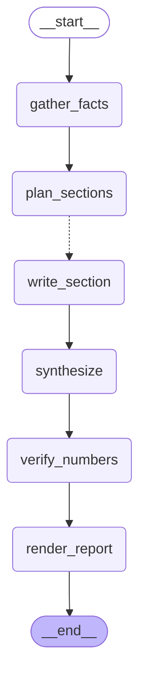

# Quarterly report with planned sections

> Write a quarterly sales report whose sections are chosen from what the data shows, with every number traced back to computed facts and unsupported figures flagged.

| | |
|---|---|
| **Example id** | `report_orchestrator` |
| **Category** | Core workflows |
| **Difficulty** | intermediate |
| **Models** | OpenAI chat |
| **Data** | `sales.csv` |
| **LangGraph features** | Send (orchestrator-workers), operator.add reducer + order restoration, Overwrite reset, post-hoc verification node, input/output schemas |
| **Source** | [`src/deepdive/examples/report_orchestrator.py`](../../src/deepdive/examples/report_orchestrator.py) |

---

## Problem

A finance lead wants a quarterly sales report. What deserves a section depends on the quarter: 2026Q2 has the
Lumen Cam Pro recall (returns need their own section) and the Lumen Therm price cut (pricing does), while an
uneventful quarter needs neither. A fixed template either misses the story or pads quiet quarters. And a report
that a language model has written from memory is worthless to finance: every figure has to come from the data.

## Design

Facts first, prose last, and a check in between that does not trust the prose.

  1. gather_facts      deterministic pandas (via `_sales_tools`): KPIs, revenue / units / return rate by product,
                       region and channel, change against the like-for-like previous quarter, price changes, and
                       z-score anomaly flags (a product's average month this quarter, for revenue or return
                       rate, against the same product's other months; |z| >= 2, at most 5 flags). Every fact has
                       a stable key and a one-line text with the numbers already computed, so no model does
                       arithmetic.
  2. plan_sections     an LLM planner reads the fact catalog and picks 3 to 6 sections; each section names the
                       fact keys it needs. Unknown keys are discarded in code. Two code guards: if the planner
                       returns fewer than 3 usable sections, default ones fill in; and any flagged anomaly the
                       planner did not cover gets an "Other flagged changes" section, so the planner cannot
                       silently drop the recall.
  3. write_section     one worker per section, started with `Send`. Each worker receives ONLY the facts its
                       section asked for, which keeps prompts small and makes "this number came from these facts"
                       checkable.
  4. synthesize        puts the sections back in planned order and writes the executive summary.
  5. verify_numbers    deterministic: every number in each narrative must appear in the facts that were supplied
                       (within the precision it was written with). Anything else is reported in the output and at
                       the end of the report. The run does not fail: the finance lead sees the report AND the list
                       of figures to distrust.
  6. render_report     assembles the markdown.

Why the previous quarter is "like-for-like": the data begins on 2025-11-01 and ends on 2026-10-31, so 2025Q4 and
2026Q4 are partial. Comparing October with the whole of Q3 would show a fake collapse of roughly 70%, so a
partial quarter is compared with the same days of the prior quarter, and a quarter whose predecessor is not fully
covered (2025Q4, 2026Q1) says so instead of inventing a change.

## Graph

```text
START -> gather_facts -> plan_sections --(one Send per section)--> write_section x N (parallel)
                                                                          |
              END <- render_report <- verify_numbers <- synthesize <------+
```

## LangGraph features

* orchestrator-workers: a conditional edge returns one `Send("write_section", payload)` per planned section,
  so the number of parallel workers is decided at run time by the model's plan
* a worker payload that is NOT the graph state (each worker sees only its own facts)
* an `operator.add` reducer collects the workers' drafts; `synthesize` sorts them by planned index because
  the order in which parallel results are merged is an implementation detail you should not rely on
* `Overwrite([])` resets the reducer list at the start of each run, so a second run on the same Studio thread
  does not append to the first
* input/output schemas; deterministic nodes around the LLM nodes

## Models and data

OpenAI chat model: structured output for the plan, plain text for sections and the summary. Data: `sales.csv`.
Offline, the stand-in planner returns keys that do not exist, so the default three-section plan is used and the
"narratives" are placeholder text; the facts, the section fan-out, the ordering and the verification are real.
Limits: the number check catches figures that are not in the facts, not wrong words ("rose" for "fell"), and it
ignores years and whole numbers up to 10. Spelled-out numbers are not checked.

## Try it in Studio

Pick a quarter from the "Ready-made case" dropdown and press Submit (on a new thread a blank form runs the first one).
The data covers 2025-11-01 to 2026-10-31, so these five quarters are all there is. Open `gather_facts` to see the
fact catalog, `plan_sections` to see which sections the planner chose, then watch the graph fan out to one
`write_section` run per section. Check `verification` in the output for numbers that did not come from the facts.
  * `2026Q2`: the two stories. `anomaly.lumen_cam_pro.return_rate` (the recall) and `pricing.lumen_therm` (the
    $159 -> $149 price cut) are in the catalog; the recall always gets a section, whatever the planner chose.
  * `2026Q3`: no anomaly facts, so a quieter plan; the Therm price cut is already in force for the whole quarter.
  * `2026Q4`: October only, labelled partial and compared with July (the same days), not with all of Q3.
  * `2026Q1`: a full quarter, but the dataset does not fully cover 2025Q4, so the report says there is no
    like-for-like previous quarter instead of inventing a change.
  * `2025Q4`: November and December only; no previous quarter, and the holiday peak shows up as a flag on Lock revenue.
The same by hand: `{"quarter": "2026Q2"}`. A quarter the data does not cover (`2024Q1`) or that is not written
like `2026Q2` is refused with a clear message.

## Extend it

Let a worker call `_sales_tools.query_sales` for a drill-down the facts do not contain (and add those results to
the verification set). Add a human approval step before the report is published. Run the planner twice and keep
the sections both runs agree on.

## Compiled graph

Drawn from the compiled graph by `scripts/gen_docs.py` (one level of subgraphs expanded).



## Ready-made cases in Studio

The input form has a **Ready-made case** dropdown, so you do not need to know the data. Pick one and press Submit; a blank form on a new thread runs the first.

| # | Case (as shown in the dropdown) | Input it stands for |
|---|---|---|
| 1 | 2026Q2 revenue $33,848.40, return rate 7.9% -> Cam Pro return spike is flagged and always gets a section | `{"quarter": "2026Q2"}` |
| 2 | 2026Q3 revenue $44,808.20, no anomaly flags -> a quieter plan; Therm's $149 price is already in force | `{"quarter": "2026Q3"}` |
| 3 | 2026Q4 October only, 31 of 92 days -> labelled partial, compared with July rather than all of Q3 | `{"quarter": "2026Q4"}` |
| 4 | 2026Q1 full quarter, no like-for-like previous quarter -> the report says there is nothing to compare with | `{"quarter": "2026Q1"}` |
| 5 | 2025Q4 Nov-Dec only, 61 of 92 days -> no previous quarter; Lock revenue flagged (holiday peak) | `{"quarter": "2025Q4"}` |

## Example input

```json
{
  "quarter": "2026Q2"
}
```

Run it: `uv run langgraph dev`, open Studio, choose `report_orchestrator`, pick a case from the **Ready-made case** dropdown, or paste the input above.
