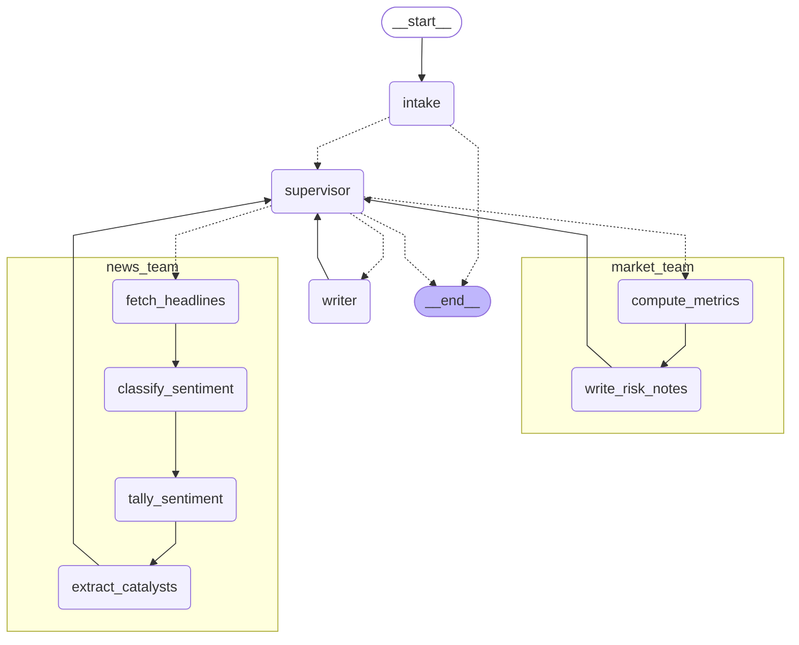

# Hierarchical research supervisor

> Produce a one-page company brief in which numbers come from code, interpretation from specialist teams, and every sentence is traceable to a fact, with a supervisor that cannot loop or skip the brief.

| | |
|---|---|
| **Example id** | `research_supervisor` |
| **Category** | Multi-agent |
| **Difficulty** | advanced |
| **Models** | OpenAI chat |
| **Data** | `companies.csv`, `prices.csv`, `news_headlines.csv` |
| **LangGraph features** | hierarchical supervisor, Command routing, subgraphs with private state, reducers (audit trail), loop bounds, subgraph streaming, structured output |
| **Source** | [`src/deepdive/examples/research_supervisor.py`](../../src/deepdive/examples/research_supervisor.py) |

---

## Problem

An analyst wants a one-page brief on one of the (fictional) listed companies. A single agent holding every tool
does shallow work, lets narrative bleed into the numbers ("shares are volatile" with no volatility figure), and
cannot show where any sentence came from. The brief is only useful if each claim can be traced to a fact.

## Design

Three layers, each doing the job it is good at:

  * `supervisor` (model, structured output `Decision`) reads the analyst's question and chooses the next
    worker plus a one-line instruction. It never touches data. Code, not the model, enforces the rules that must
    always hold: a worker runs at most once, the brief cannot be skipped, and a hop budget (`max_hops`) forces
    the writer to run when it is spent. (With once-only workers a runaway loop is already impossible; the budget
    also lets you ask for a quick brief: `max_hops=1` consults one team.)
  * Two **team subgraphs** with their own *private* state, wrapped by mapping functions so the parent never sees
    their internals:
      - `market_team`: deterministic price analytics (5/20/60-day returns, 20-day realised volatility, drawdown
        from the 60-day closing high, price vs the 50-day average), then a model that writes risk notes from
        those numbers only - each note must cite the metric ids it relies on.
      - `news_team`: fetch the ticker's recent headlines, classify each one (model, structured), tally the
        sentiment in code, then a model proposes catalysts, each citing headline ids.
    Numbers are code; interpretation is a model; every model sentence must point at ids code can check.
  * `writer` (model, structured `BriefDraft`) turns the numbered fact list into bullets, each with `fact_ids`.
    Code drops any bullet whose ids are missing or unknown, renders the page itself, and lists numbers in a bullet
    that do not appear in the cited facts. If nothing survives it prints the raw fact sheet instead of an
    unverifiable draft. The text is therefore never free-form model prose.

Failure modes this structure prevents: a team being asked twice (double cost), the supervisor ending the run
before a brief exists, an unknown ticker burning model calls (it is rejected before any model runs), and
plausible-but-unsourced sentences reaching the page.

## Graph

```text
START -> intake --(unknown ticker)--> END
            |
            v
        supervisor --Command(goto)--> market_team  [compute_metrics -> write_risk_notes]
          ^    |                      news_team    [fetch_headlines -> classify_sentiment -> tally_sentiment
          |    |                                    -> extract_catalysts]
          |    |                      writer       [drafts bullets with fact ids; code audits and renders]
          |    +--(writer already ran)--> END
          +-------- every worker reports back to the supervisor --------+
market_team and news_team are subgraphs with private state; ``supervisor`` is the only node that decides routing.
```

## LangGraph features

* `Command(goto=..., update=...)` from the supervisor: routing and bookkeeping in one step, no conditional edges
* subgraphs with private state schemas, called from wrapper nodes that map state in and out (the parent keeps only
  each team's facts); streamable with `subgraphs=True`, where each team's steps appear under its own namespace
* a reducer (`operator.add`) on `done` and `trail` so each hop appends to the run's audit log; `intake` resets
  both with `Overwrite([])`, because Studio reuses the thread and a leftover `writer` in `done` would end the next run at once
* explicit loop bounds: once-only worker flags plus `max_hops`, both enforced in code and tested
* separate `input_schema` / `output_schema` and OpenAI-strict structured output on every model decision

## Models and data

OpenAI chat (fast tier for the supervisor and classifier, default for notes, catalysts and the writer). Data:
`companies.csv`, `prices.csv` (160 trading days to 2026-10-30) and `news_headlines.csv`. Everything is
fictional: the output says "not investment advice" and offers no forecasts. The headline `label` column is NOT
used by the graph (it is the model's answer key; see EXTEND IT). Offline, the placeholder model output cites ids that
do not exist, so the checks drop it and the run shows the code-only parts: metrics, the headline list and the
fact sheet (the supervisor's route is arbitrary but stable).

## Try it in Studio

Input `{"ticker": "ACMR"}`: watch `supervisor` hand off market_team, news_team, writer, then end; open the
`trail` in the output to see each decision (and whether the model or a rule made it). Each team is invoked from a
wrapper node, so the static graph shows one node per team; their inner steps appear in the run trace and in
`stream(..., subgraphs=True)` under the namespaces `market_team:<id>` / `news_team:<id>` (not checked in Studio
itself; the tests print them). Then try:
  * `{"ticker": "CBLT", "question": "Is the recent price weakness explained by the news?"}`
  * `{"ticker": "HELO", "max_hops": 1}` - the budget is spent after one team, so the writer is forced and the
    brief says the other team was not consulted
  * `{"ticker": "NOPE"}` - a clean `error` and no model call
Tickers: ACMR BORE CBLT DLPH EMBR FTHM GRNT HELO.

## Extend it

Score the news classifier against the dataset's `label` column (the dataset marks ~15% of headlines as tricky).
Run both teams in parallel with `Send` when the question needs both, keeping the supervisor for ambiguous
questions. Add a `reviewer` worker that re-checks the draft's numbers with a second model before rendering.

## Compiled graph

Drawn from the compiled graph by `scripts/gen_docs.py` (one level of subgraphs expanded).



## Example input

```json
{
  "ticker": "ACMR",
  "question": "Give me a one-page brief: price action, risk and news."
}
```

Run it: `uv run langgraph dev`, open Studio, choose `research_supervisor`, paste the input above.
