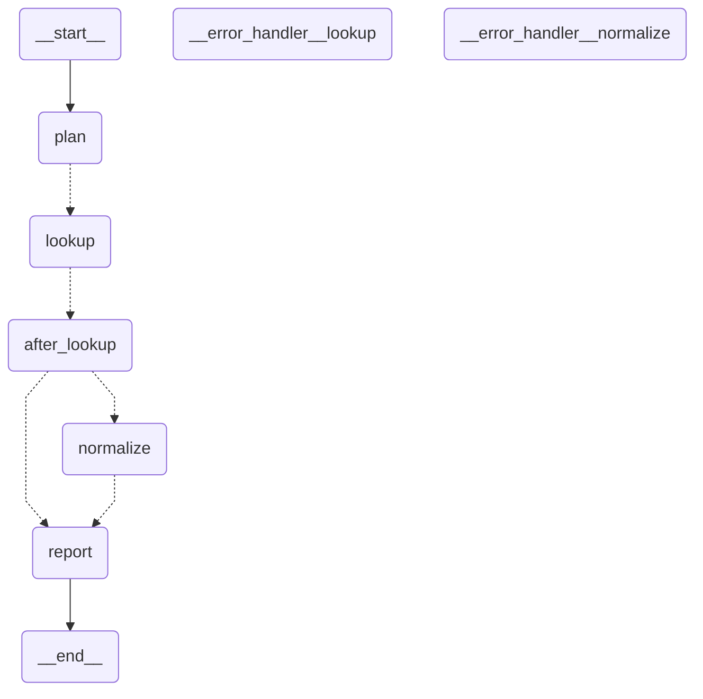

# Resilient batch enrichment (retry, cache, timeout, progress)

> Enrich a batch of company records from a flaky vendor API so that transient errors are retried, repeat lookups hit a cache, one bad record never sinks the batch, and the operator sees live progress.

| | |
|---|---|
| **Example id** | `resilient_enrichment` |
| **Category** | Runtime & resilience |
| **Difficulty** | advanced |
| **Models** | none (simulated vendor API) |
| **Data** | `companies.csv` |
| **LangGraph features** | RetryPolicy, CachePolicy, error_handler / NodeError, TimeoutPolicy, custom streaming, Send fan-out |
| **Source** | [`src/deepdive/examples/resilient_enrichment.py`](../../src/deepdive/examples/resilient_enrichment.py) |

---

## Problem

A sales-ops team enriches a batch of company records (industry, headcount, headquarters) from a third-party data
vendor. The vendor is unreliable in the usual ways: requests time out or get HTTP 429 and succeed a moment later,
for one company the vendor's upstream source is down for the whole run, and a few records are simply bad (the
vendor answers 404 and always will). The job has to survive all of that: one bad record must not sink the other
39, transient failures must be retried with backoff (and only transient ones), a company that was already looked
up should not cost another paid call, and the operator watching the run wants to see progress while it happens.

Everything the vendor does is SIMULATED in this file (no network): `vendor_fetch(domain, attempt)` is a pure
function whose failures depend only on the domain and the attempt number, so every run, and every test, behaves
exactly the same way.

## Design

Failures are sorted into two kinds at the point where they are raised, because they need opposite treatment:

  * `TransientVendorError` (timeouts, 429, 503): worth retrying. The node's `RetryPolicy` is told to retry on
    this class only, up to 4 attempts with exponential backoff and jitter.
  * `PermanentVendorError` (404, malformed domain): retrying is wasted money. It is not in `retry_on`, so it
    goes straight to the node's `error_handler`.

When retries are exhausted (or the error is permanent) LangGraph calls the node's `error_handler`. The handler
records a `failed_*` result for that one domain and routes on to the next stage, so the rest of the batch is
untouched. Without a handler a single failure would raise out of the whole run.

Duplicates and the cache. `plan` groups records by domain and fans out ONE lookup per unique domain
(a duplicate within a batch never reaches the vendor). Across runs the cache takes over: `lookup` has a
`CachePolicy` keyed on the domain alone, so re-running a batch - for instance after the vendor has recovered -
serves the companies that succeeded from the cache and calls the vendor only for the ones that failed (failed
attempts are never cached). Entries expire after `CACHE_TTL_S` (10 minutes here; pick what your data tolerates). The key matters: the default key hashes the whole Send payload, which here includes
the batch id, so every run would miss. Why not rely on the cache for duplicates inside one batch too? Because
parallel tasks of one step are all scheduled before any of them finishes, so both would call the vendor (verified).

Graceful degradation. After a successful lookup, `normalize` maps vendor labels to our taxonomy through a
simulated slow service, guarded by a `TimeoutPolicy`. When it times out, the handler keeps the RAW vendor values
and marks the record `enriched_unnormalized`: a slightly worse answer now beats a hung job.

Progress is a UI concern, so it goes out through `get_stream_writer()` as custom events and not through graph
state: `plan` (batch size), `transient_error` (what failed and whether it will be retried), `progress`
("looked up 7/13"), `cache_hit`, `normalized` / `degraded` and a final `done`.
Two LangGraph behaviours shape the code (both verified on 1.2.20):

  * A cache hit replays the node's WRITES but does not run the node, so the node cannot announce its own cache
    hit. Each lookup result is therefore stamped with the id of the batch that really called the vendor; any
    result carrying an older batch id was served from the cache, and `after_lookup` reports it.
  * A plain join is enough for `report`, and `defer=True` would change nothing here (verified by running this
    example both ways: one `report` run, same summary). Nothing writes to `report` until the second-stage
    `normalize` tasks, which all run in one step, so it fires once, after them. `defer` is NOT a barrier for
    `Send` stages in general: if another branch has already written to the join and the only work left is a
    `Send`, the deferred join runs alongside those `Send` tasks and again afterwards (a pending `Send` does
    not count as scheduled work; see docs/AUTHORING.md). If you add branches of uneven length, test the join.

## Graph

```text
START -> plan -- Send per unique domain --> lookup ----------------------------> after_lookup
                                             retry (transient errors only)          | finds the cache hits, emits events
                                             cache keyed by domain                  |
                                             error_handler -> failed_* result ----->+
                                                                                    +-- Send per success --> normalize --> report --> END
                                                                                    |    (async, TimeoutPolicy; the handler    ^
                                                                                    |     keeps raw values on timeout) --------+
                                                                                    +-- nothing succeeded ---------------------+
```

## LangGraph features

* `RetryPolicy(retry_on=TransientVendorError)`: backoff for transient errors only. `runtime.execution_info.node_attempt`
  gives the node its attempt number, which is how the simulated vendor knows "this is the 3rd call".
* `CachePolicy(key_func=..., ttl=...)` with `compile(cache=...)`: paid lookups are reused. `build_graph`
  supplies an in-memory cache unless you pass one, so Studio re-runs share it for the life of the server process.
* `error_handler` + `NodeError`: contain one record's failure; the handler runs after the retries are used up.
* `TimeoutPolicy(run_timeout=...)` on an `async` node (timeouts only work through asyncio cancellation).
* `get_stream_writer()` custom events for live progress.
* `Send` fan-out, `Command(goto=[Send, ...])` for the second fan-out, and `Overwrite` to reset the
  accumulating result lists at the start of each run on a thread.

## Models and data

No model: this example is about runtime behaviour, and the vendor is a simulation. Data: `companies.csv` supplies
the eight listed companies of the default batch; the rest are made-up private companies defined in this file.
Special domains in `SCENARIOS` misbehave on purpose (see the table in the code).

## Try it in Studio

1. Input `{"count": 14}` (the default sample). Run it as a normal run; the whole thing takes a few seconds because
   of the real backoff sleeps and the 1 s normalisation timeout. Output `summary` should read: 14 records, 13
   unique domains, 11 enriched, 1 enriched_unnormalized (Slowpoke Systems, timed out), 1 failed_permanent
   (Ghostcorp, 404, 1 attempt), 1 failed_retries_exhausted (Meridian Grid, 4 attempts), 8 retries used,
   21 vendor calls, 0 cache hits.
2. Run the SAME input again (same server process). The 11 companies that succeeded come from the cache
   (`cache_hits: 11`); only the two failing domains call the vendor again (5 calls, 3 retries).
3. Watch the custom stream events (they are emitted while the run is in progress; if your Studio view does not show
   them, call the API with `stream_mode="custom"`). Look for `transient_error` with `will_retry: true`, then
   `progress` counting up, `cache_hit` on the second run and one `degraded` for Slowpoke Systems.
4. Your own records: `{"records": [{"company": "Foo", "domain": "foo.example"}, {"company": "Bar", "domain": "not a domain"}]}`
   (the malformed domain becomes a `failed_permanent` with no retries; `record_id` is optional).
A synchronous `graph.invoke(...)` cannot enforce timeouts, so LangGraph refuses to run `normalize` that way and
every record comes back `enriched_unnormalized` with that reason. Use `ainvoke` / `astream` (Studio does).

## Extend it

Respect a vendor rate limit by running the fan-out in waves (a loop that dispatches N domains at a time); add a
`RetryPolicy` for `NodeTimeoutError` on `normalize` before degrading; or persist failed domains in the Store so
tomorrow's run starts with them.

## Compiled graph

Drawn from the compiled graph by `scripts/gen_docs.py` (one level of subgraphs expanded).



## Example input

```json
{
  "count": 14
}
```

Run it: `uv run langgraph dev`, open Studio, choose `resilient_enrichment`, paste the input above.
