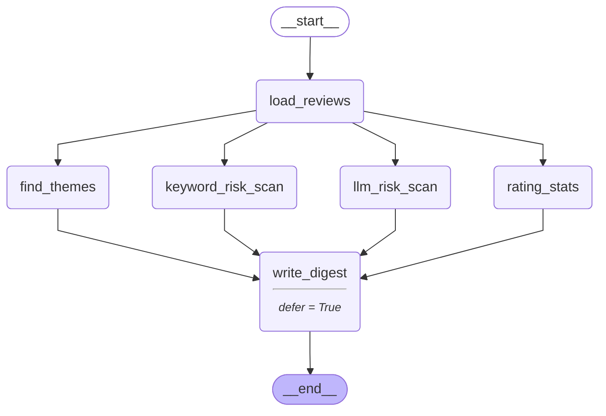

# Parallel review digest with a guaranteed risk section

> Summarise a product's recent customer reviews (statistics, themes, risks) in parallel while guaranteeing that a safety, legal or privacy report is never missed or buried.

| | |
|---|---|
| **Example id** | `review_insights_parallel` |
| **Category** | Core workflows |
| **Difficulty** | starter |
| **Models** | OpenAI chat |
| **Data** | `product_reviews.csv` |
| **LangGraph features** | parallel fan-out, operator.add reducer + Overwrite reset, defer=True join, input/output schemas, deterministic + LLM union |
| **Source** | [`src/deepdive/examples/review_insights_parallel.py`](../../src/deepdive/examples/review_insights_parallel.py) |

---

## Problem

A product team wants a weekly digest of customer reviews for one product: how people rate it, what they keep
talking about, and whether anyone reports something dangerous or legally sensitive. The three questions are
independent, so they should run side by side. The risk question is the one that matters most: a review that says
"the plug smelled of burning plastic" must reach the team whatever the language model happens to notice that day,
and it must not be buried under the praise.

## Design

The graph fans out from one loader into branches that do not need each other:

  * rating_stats      pure pandas: rating histogram, mean, verified share. No model, so the numbers are exact.
  * find_themes       one structured-output LLM call. Every theme must cite review ids as evidence; ids the model
                      invents are removed in code, and a theme left with no real evidence is dropped.
  * keyword_risk_scan a deterministic regex scan (fire, burn, smell, spark, shatter, injur, lawyer, privacy,
                      counterfeit, locked out ...). High recall, low precision, and it shows which words matched.
  * llm_risk_scan     a second, independent risk pass by the model, which understands context the regex cannot.

The two risk scanners both append to one list (`risk_findings`), so the risk result is the UNION of the two.
That is the point of the design: if the model misses a burning-plug review, the regex still reports it; if the
regex has no word for a problem, the model can still report it. A model miss cannot hide a risk.

The digest itself is assembled by code, not written by a model, for the same reason: *where* the Risks section
goes is a guarantee, not a suggestion. When anything is flagged it is the first section of the digest; when
nothing is flagged a one-line "risk check" at the end says the scan ran and found nothing.

The join node is `defer=True`. Today that changes nothing: all four branches finish in the same superstep, so a
plain fan-in also runs `write_digest` exactly once (checked by running the graph both ways). It is a guard for
the next edit. If one branch gains a second step reached by a plain edge (a model call followed by a validation
node), a plain join would run twice, the first time with that branch missing, while a deferred join runs once,
after everything. The guard covers plain edges only: a branch that continues through `Send` does not hold a
deferred join back once another branch has already written to it (see docs/AUTHORING.md).

## Graph

```text
                   +--> rating_stats -------+
                   +--> find_themes --------+
START -> load_reviews                        +--> write_digest (defer) -> END
                   +--> keyword_risk_scan --+
                   +--> llm_risk_scan ------+
```

## LangGraph features

* static parallel fan-out: four edges leave `load_reviews`, so the four nodes run in the same superstep
* a reducer (`operator.add`) on `risk_findings` so two nodes can write the same key in one step; without a
  reducer LangGraph raises `InvalidUpdateError`. `load_reviews` resets it with `Overwrite([])` (Studio
  shows an `__overwrite__` marker in that node's output) so re-running on the same thread does not pile up
  findings from the previous run
* `add_node(..., defer=True)` for the fan-in: a no-op safeguard today (see DESIGN) that keeps the digest to one
  run, after all branches, if a branch later gains a second plain-edge step
* separate `input_schema` / `output_schema`
* a deterministic + LLM mix: the model is used where judgement is needed, code where a guarantee is needed

## Models and data

OpenAI chat model with structured output (themes, risk findings). Data: `product_reviews.csv` (320 reviews of
the eight Lumen Home products; six are seeded with fire, injury, legal, privacy, counterfeit or lock-in language,
and two more are lock-out complaints).
Offline, the stand-in model returns placeholder ids that fail validation, so you will see real statistics and
keyword risks but no themes; run it live for themes.

## Try it in Studio

Input `{"product": "Lumen Plug 4-pack"}`. The burning-plug review R-0315 is flagged in `keyword_risk_scan`
even if `llm_risk_scan` returns nothing, and the digest opens with a Risks section. Open the four parallel
nodes to compare their outputs, then `write_digest` to see them merged (`detected_by` shows which detector
fired). Try `{"product": "Lumen Therm", "max_reviews": 20}` (a legal threat), `"Lumen Cam Pro"` (privacy)
or `"Lumen Lock"` (three flags: a jammed lock and two lock-outs). `"Lumen Bell"` has no risk language, so the Risks section
gives way to a one-line risk check at the end of the digest.

## Extend it

Add a fifth branch that compares this week's mean rating with the previous period. Send high-severity findings
to a human with `interrupt()` before the digest is published. Replace the keyword list with the Decisions API
(one `predicate` per risk category) when you want calibrated probabilities instead of a yes/no list.

## Compiled graph

Drawn from the compiled graph by `scripts/gen_docs.py` (one level of subgraphs expanded).



## Example input

```json
{
  "product": "Lumen Plug 4-pack"
}
```

Run it: `uv run langgraph dev`, open Studio, choose `review_insights_parallel`, paste the input above.
