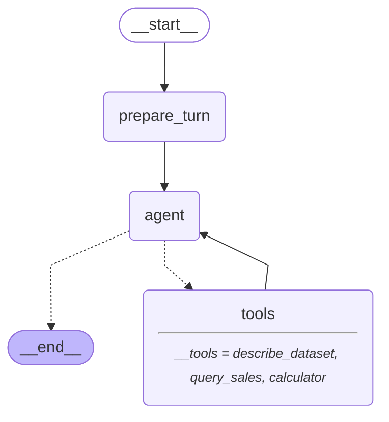

# Chat with the sales data (bounded ReAct agent)

> Let an analyst chat with the sales data and get exact numbers from tools, with tool errors recovered, the tool loop capped and the chat history trimmed.

| | |
|---|---|
| **Example id** | `sales_react_agent` |
| **Category** | Agents & tools |
| **Difficulty** | starter |
| **Models** | OpenAI chat (tool calling) |
| **Data** | `sales.csv` |
| **LangGraph features** | add_messages + RemoveMessage trimming, ToolNode + handle_tool_errors, tools_condition loop, bounded agent loop, token streaming |
| **Source** | [`src/deepdive/examples/sales_react_agent.py`](../../src/deepdive/examples/sales_react_agent.py) |

---

## Problem

An operations analyst wants to chat with the sales data: "Which region had the highest return rate for Cam Pro last
quarter?", "How did Europe do in October compared with July?". The answers feed decisions, so the numbers must be
exact. A model asked for a figure will happily produce a plausible one, and a model left in a tool loop can call
tools forever or drag an ever-growing chat history into every request.

## Design

A hand-built ReAct loop (the same shape as `create_react_agent`, written out so each part is visible and
adjustable), with four guard rails:

  * Numbers come from tools. The system prompt requires a tool result behind every figure and gives the model a
    `query_sales` tool (group by product / region / month ..., with filters, over exact pandas code in
    `_sales_tools`), a `describe_dataset` tool, and the shared `calculator` for arithmetic. The prompt also
    resolves relative dates for it ("last quarter" is 2026Q3 because the dataset's "today" is 2026-10-31), a classic
    place for a model to be quietly wrong.
  * Tool errors are conversation, not crashes. `ToolNode` is created with a `handle_tool_errors` function, so
    an unknown product or a malformed period comes back as an error `ToolMessage` (with the list of valid
    values) and the model corrects itself on the next turn.
  * The tool loop is bounded by a counter in state. `prepare_turn` resets `tool_rounds` to 0 for each user
    message; every model reply that asks for tools increments it. When it reaches `max_tool_rounds` (default 5)
    the next model call is made WITHOUT tools and with a note to answer from what it has, so a model that never
    stops asking cannot loop, and the user still gets a partial answer instead of an error.
  * The history is bounded. `prepare_turn` trims the stored conversation to a token budget before the model
    sees it: whole older messages are removed from state with `RemoveMessage` (so the checkpoint stays small, not
    only the prompt), the window always starts at a user message so tool calls are never separated from their
    results, and the newest question is always kept. Trimming once per user message is enough: inside a turn the
    history can only grow by the tool rounds, which the previous guard rail caps.

## Graph

```text
START -> prepare_turn -> agent --(no tool calls)--> END
                          ^ |
                          | +--(tool calls)--> tools
                          +---------------------+
```

## LangGraph features

* `messages` state with the `add_messages` reducer, plus a `RemoveMessage` trim step
* `ToolNode` with `handle_tool_errors` and `tools_condition` (the prebuilt pieces, wired by hand)
* `model.bind_tools` inside a node, and a tool-less call at the loop limit
* an explicit loop counter in state instead of the recursion limit
* token streaming: run with `stream_mode="messages"` and filter on `metadata["langgraph_node"] == "agent"` to
  show only the analyst's words (tool results are separate messages from the `tools` node)

## Models and data

OpenAI chat model with tool calling. Data: `sales.csv`. Offline, the stand-in model picks one tool by keyword
overlap, fills its arguments with placeholders, and then repeats the tool output as its "answer", so you see the
ReAct loop run once but not a real analysis: run live for that. Limits: the model can still misread a question or
pick a poor grouping, and nothing in this graph verifies that the final text only quotes tool results (the prompt
requires it and the tool calls are visible in the trace; `report_orchestrator` shows a deterministic number
check you could add after the `agent` node).

## Try it in Studio

Open the `Ready-made case` dropdown, pick one and press Submit (or leave the form blank on a new thread: that runs
the first one). Each case is an opening question plus a tool-round limit; the tool results show how many order lines
each figure rests on:
  * `Which region had the highest return rate for Lumen Cam Pro last quarter?` - APAC leads at 20%, on only 10
    order lines; a good answer says the rate is shaky. Then follow up in the same thread (type in the chat) with
    "And in the quarter before?" to see history and the quarter arithmetic at work.
  * `Compare Europe's October revenue with July's` (3 rounds) - two figures, then the calculator for the change.
  * `What did customers say about the Therm price?` - the sales data has no such field, so a good run says so.
  * `How many Lumen Doorbells did we sell last quarter?` - the product is called `Lumen Bell`; a wrong name
    comes back as an error `ToolMessage` listing the valid ones, and the model corrects itself.
  * `What products and regions does the data cover, and what is 'last quarter'?` - the `describe_dataset` tool.
  * `How did each product's revenue change from Q2 to Q3?` (1 tool round) - more work than one round allows; watch
    the next model call be made without tools and answer from what it has.
To ask your own, paste `{"messages": [{"role": "user", "content": "Compare Europe's October revenue with July's"}],
"max_tool_rounds": 3}`.

## Extend it

Add a `plot_series` tool that returns chart data for the UI to render. Persist per-user preferences (default
region, currency) in the store and put them in the system prompt. Replace the token-budget trim with a summary of
the dropped messages.

## Compiled graph

Drawn from the compiled graph by `scripts/gen_docs.py` (one level of subgraphs expanded).



## Ready-made cases in Studio

The input form has a **Ready-made case** dropdown, so you do not need to know the data. Pick one and press Submit; a blank form on a new thread runs the first.

| # | Case (as shown in the dropdown) | Input it stands for |
|---|---|---|
| 1 | Which region had the highest return rate for Lumen Cam Pro last quarter? -> APAC 20% on just 10 lines: watch the caveat | `{"messages": [{"role": "user", "content": "Which region had the highest return rate for Lumen Cam Pro last quarter?"}]}` |
| 2 | Compare Europe's October revenue with July's (3 rounds) -> gross $5,254.70 vs $3,446.30: watch the calculator | `{"messages": [{"role": "user", "content": "Compare Europe's October revenue with July's"}], "max_tool_rounds": 3}` |
| 3 | What did customers say about the Therm price? -> the sales data has no review text: does a good run say so? | `{"messages": [{"role": "user", "content": "What did customers say about the Therm price?"}]}` |
| 4 | How many Lumen Doorbells did we sell last quarter? -> no such product ('Lumen Bell'): watch for an error, then a retry | `{"messages": [{"role": "user", "content": "How many Lumen Doorbells did we sell last quarter?"}]}` |
| 5 | What products and regions does the data cover, and what is 'last quarter'? -> watch describe_dataset: it says 2026Q3 | `{"messages": [{"role": "user", "content": "What products and regions does the data cover, and what is 'last quarter'?"}]}` |
| 6 | How did each product's revenue change from Q2 to Q3, in percent? (1 tool round) -> watch the cap stop the loop | `{"messages": [{"role": "user", "content": "How did each product's revenue change from Q2 to Q3, in percent?"}], "max_tool_rounds": 1}` |

## Example input

```json
{
  "messages": [
    {
      "role": "user",
      "content": "Which region had the highest return rate for Lumen Cam Pro last quarter?"
    }
  ]
}
```

Run it: `uv run langgraph dev`, open Studio, choose `sales_react_agent`, pick a case from the **Ready-made case** dropdown, or paste the input above.
