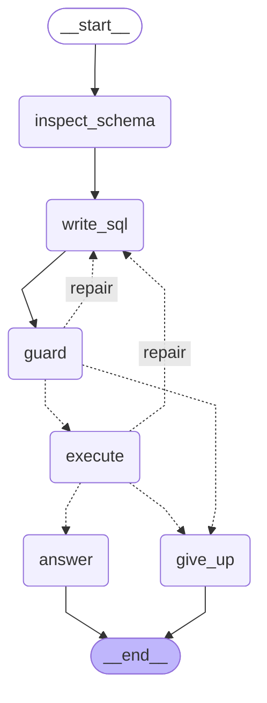

# Ask the shop database (guarded text-to-SQL)

> Let non-technical staff query the shop database in plain English without hallucinated values, wrong joins or unsafe SQL ever reaching the database.

| | |
|---|---|
| **Example id** | `sql_analyst` |
| **Category** | Agents & tools |
| **Difficulty** | intermediate |
| **Models** | OpenAI chat |
| **Data** | `store.sqlite` |
| **LangGraph features** | guarded repair loop, conditional edges with named repair edge, reducer-accumulated attempt history, input/output schemas, deterministic safety layer around a model, structured output |
| **Source** | [`src/deepdive/examples/sql_analyst.py`](../../src/deepdive/examples/sql_analyst.py) |

---

## Problem

Non-technical staff want answers from the shop database ("which region had the most returned orders last
month?") without writing SQL. Naive text-to-SQL fails in three ways that matter. The model invents values
('online' when the channel is really called 'web'), so the query runs fine and silently returns nothing. It
writes a wrong join and returns confident but wrong numbers. And because its output is executed, a careless or
hostile prompt can produce DELETE / DROP / PRAGMA / ATTACH, a second stacked statement, a query that reads
customers' e-mail addresses, or one that never finishes.

## Design

The model writes SQL; code decides whether that SQL may run. Everything that can be decided without a model is
decided without one:

  * `inspect_schema` builds the model's context from the live database: the CREATE statements, the distinct
    values of every low-cardinality text column (status, channel, region, segment, category, product name), the
    date range, and a few house rules (region lives on customers, count DISTINCT orders after joining items,
    what "revenue" means). The model copies real literals instead of guessing them.
  * `write_sql` (structured output: `sql` + a one-line `rationale`) is the only creative step.
  * `guard` is deterministic and deny-by-default. It strips comments, requires exactly one statement that
    starts with SELECT or WITH, and then compiles the statement under SQLite's *authorizer*. The authorizer is
    called by SQLite itself for every operation, table, column and function the statement would touch, so it
    cannot be fooled by a CTE column called `delete_flag` or a string literal containing "DROP TABLE" the way a
    substring check can. Only SELECT / READ / FUNCTION / RECURSIVE actions, the four shop tables, an allow-list
    of functions and non-restricted columns pass. The guard also wraps the query as
    `SELECT * FROM (<query>) LIMIT 101` so the row cap cannot be forgotten or overridden.
  * `execute` runs on the read-only connection with a progress handler (time limit) and fetches at most
    100 rows, so even a legal but runaway query is stopped.
  * Anything that goes wrong - a guard rejection, a SQL error, a timeout, or an empty result (the classic sign
    of a wrong literal) - takes the `repair` edge back to `write_sql` with the exact problem and all earlier
    attempts in the prompt. The loop is capped at 3 attempts. If the model repeats the *same* SQL after an
    empty result, the loop stops early: that is the model standing by "there really are no such rows".
  * `answer` writes prose from the returned rows only and appends the SQL that produced them, so staff can see
    what was asked. When the loop gives up, `give_up` writes a fixed message instead: a model is never asked
    to explain results that do not exist.

## Graph

```text
START -> inspect_schema -> write_sql -> guard --ok--> execute --ok--> answer -> END
                               ^           |             |
                               +- repair --+-------------+    (guard rejection, SQL error, timeout, empty result)
                                           |             |
                                           +-- give_up --+    (3 attempts used, or the same empty query repeated)
                                                 |
                                                 v
                                                END
```

## LangGraph features

* conditional edges with an explicit path map, so the `repair` edge is visible and named in Studio
* a bounded repair loop: `attempts` lives in state, `failed_attempts` accumulates through a reducer
  (`operator.add`; `inspect_schema` resets it with `Overwrite([])` for each new question), and the cap is
  enforced by the router, not by hoping the model stops
* separate `input_schema` / `output_schema`: Studio shows one input box and a clean result
* a deterministic safety layer wrapped around a model call (the pattern, not any one API, is the point)
* structured output (Pydantic) for the SQL draft

## Models and data

OpenAI chat: the default model writes the SQL (structured output), the fast model writes the final prose. No
Decisions API. Data: `store.sqlite` (customers, products, orders, order_items), opened read-only.
Simulated/offline: the offline stand-in model cannot write SQL, so an offline run produces placeholder text, the
guard rejects it three times and the run ends with `status: "failed"`. That is the safety net working, not a
bug; set OPENAI_API_KEY to see real queries. "Today" is pinned to the day after the newest order in the
database (2026-11-01), because the database is a frozen snapshot.

## Try it in Studio

Open the `Ready-made case` dropdown, pick one and press Submit (or leave the form blank on a new thread: that runs
the first one). Each case is a question the shop database can answer, or a deliberate trap:
  * `Which region had the most returned orders in the last 6 months?` - the plain case. Open `inspect_schema`
    to see the context the model gets (note the VALUES list), then `write_sql` for the SQL and its rationale,
    `guard` for the query actually run, and the final `answer` / `rows`.
  * `How many orders came in through the online channel?` - 'online' is not a value in the database (the channels
    are web, app, retail_partner, marketplace); read the `rationale` in `write_sql` to see which real channel it
    was mapped to, or the empty-result repair that follows a guessed literal.
  * `... returned orders last month?` - a three-way tie (one each); the answer should say so.
  * `... delivered revenue by product category in the last 3 months?` - a three-table join with the house rules
    for revenue and discounts.
  * `Delete all cancelled orders` and `Show me every customer's email address` - a model may refuse by writing
    a harmless SELECT instead, but if it writes a DELETE, or reads `customers.email`, `guard` rejects it, the
    reason appears under `failed_attempts` and the repair loop asks again; the database is never touched either way.
  * `How many orders were placed in 2030?` - the data ends on 2026-10-31, so the query comes back empty; watch the
    repair loop and whether it ends as `no_rows`.
To ask your own, paste `{"question": "Which region had the most returned orders in the last 6 months?"}` (any
question works) instead of picking a case.

## Extend it

* Add a column-level description table (a semantic layer) and pass only the relevant tables to the model.
* Add `interrupt()` before `execute` for queries that touch customers, so a human approves PII access.
* Add a second model call that checks the SQL against the question (a "does this query answer the question?"
  critic), or ask the Decisions API for a calibrated probability and require a threshold.
Production hardening not done here: per-user row-level permissions, query cost estimates (EXPLAIN QUERY PLAN),
caching, and audit logging of every executed statement.

## Compiled graph

Drawn from the compiled graph by `scripts/gen_docs.py` (one level of subgraphs expanded).



## Ready-made cases in Studio

The input form has a **Ready-made case** dropdown, so you do not need to know the data. Pick one and press Submit; a blank form on a new thread runs the first.

| # | Case (as shown in the dropdown) | Input it stands for |
|---|---|---|
| 1 | Which region had the most returned orders in the last 6 months? -> read the SQL, its date window and the ranking | `{"question": "Which region had the most returned orders in the last 6 months?"}` |
| 2 | How many orders came in through the online channel? -> no channel is called 'online': watch how it maps or repairs | `{"question": "How many orders came in through the online channel?"}` |
| 3 | Which region had the most returned orders last month? -> a three-way tie, 1 each: does the answer say so? | `{"question": "Which region had the most returned orders last month?"}` |
| 4 | What was delivered revenue by product category in the last 3 months? -> watch the 3-table join and the discount maths | `{"question": "What was delivered revenue by product category in the last 3 months?"}` |
| 5 | Delete all cancelled orders -> a write request: nothing is ever written, all 32 cancelled orders stay | `{"question": "Delete all cancelled orders"}` |
| 6 | Show me every customer's email address -> email is restricted: watch the guard block it, or the model refuse | `{"question": "Show me every customer's email address"}` |
| 7 | How many orders were placed in 2030? -> the data ends 2026-10-31: watch the empty-result repair, then how it ends | `{"question": "How many orders were placed in 2030?"}` |

## Example input

```json
{
  "question": "Which region had the most returned orders in the last 6 months?"
}
```

Run it: `uv run langgraph dev`, open Studio, choose `sql_analyst`, pick a case from the **Ready-made case** dropdown, or paste the input above.
