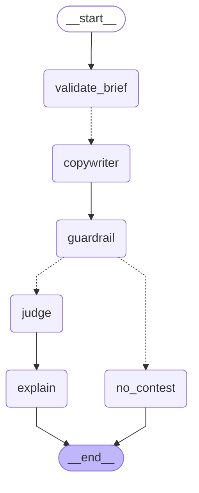

# Subject-line tournament (Decisions API judge)

> Pick the best email subject line from diverse, guardrail-filtered candidates using one calibrated, inspectable batch judgement instead of a single model draft.

| | |
|---|---|
| **Example id** | `subject_line_tournament` |
| **Category** | Decisions API |
| **Difficulty** | intermediate |
| **Models** | OpenAI chat, OpenAI Decisions API |
| **Data** | - |
| **LangGraph features** | Send fan-out, reducer, deterministic guardrail, Decisions API batch judging, conditional edge, best-of-N |
| **Source** | [`src/deepdive/examples/subject_line_tournament.py`](../../src/deepdive/examples/subject_line_tournament.py) |

---

## Problem

Email subject lines drive open rates, and a single LLM draft is a coin flip: the model's first idea is rarely its
best, and asking it to "pick the best of these" returns a confident answer with no way to see why. The team wants
several genuinely different candidates, a hard filter for the mistakes that hurt deliverability, and a pick they can
inspect and argue with.

## Design

A best-of-N tournament with the model used where it is good and code used where rules are rules:

  1. **Diversity by construction.** Six copywriter workers run in parallel (`Send`), each with a different angle:
     urgency, curiosity, social proof, benefit-first, question, minimalist. Asking one model for six variants gives
     six near-copies; six distinct instructions give six different ideas.
  2. **Guardrail in code.** Candidates over 60 characters, with an ALL-CAPS word, with a spam-trigger word or
     pattern, or that nearly duplicate an earlier candidate are rejected, with the reason recorded. These are rules
     you can state exactly, so a model never gets a vote on them.
  3. **One judge call for all survivors.** A single Decisions API request puts the brief and every surviving
     candidate in the same context and asks, per candidate, an ordered `score` for appeal (poor..excellent) and a
     `predicate` "reads as spam or clickbait", plus one `choice` over all candidates for "best overall". Judging
     together makes the comparison relative (not six independent absolute ratings), and the answers are calibrated
     probabilities, not prose. Candidates are shown in a fixed pseudo-random order seeded by the brief, because LLM
     judges favour early items; that reduces, not removes, the bias.
  4. **Ranking in code.** `adjusted = expected_appeal - SPAM_PENALTY * P(spam)`, with expected appeal rescaled to
     0..1. If the top two are within `TIE_MARGIN` the `choice` probabilities break the tie; otherwise the
     `choice` is shown but does not override the scores. Every probability is in the output table.
  5. A chat model writes a two-sentence rationale from the table only (code trims it to two sentences).

Edge cases are explicit: with fewer than two survivors there is nothing to compare, so no judge call is made
(one survivor wins by default, zero survivors returns the rejection reasons).
What this does NOT do: predict real open rates. The judge estimates how a model expects an audience to react; the
only real test is an A/B send.

## Graph

```text
START -> validate_brief --Send x6--> copywriter (urgency | curiosity | social_proof | benefit_first | question | minimalist)
                                          |  (candidates collected by an add-reducer)
                                          v
                                      guardrail --(>= 2 survivors)--> judge -> explain -> END
                                                --(0 or 1 survivor)--> no_contest -> END
```

## LangGraph features

* `Send` fan-out to a worker node with its own input (the angle) and a reducer (`operator.add`) collecting results;
  `validate_brief` resets the list with `Overwrite([])` so a second run on the same Studio thread starts empty
* a conditional edge after the join choosing between the judged path and the no-contest path
* deterministic guardrail node between generation and judging (a node boundary makes it testable and visible)
* the OpenAI Decisions API as a graph step (`decide`): batched scoring plus calibrated probabilities
* separate `input_schema` / `output_schema`

## Models and data

OpenAI chat for the six drafts and the rationale; the Decisions API (one call, 2N+1 questions for N survivors) for
judging. No dataset: the input is the brief. Offline, the drafts are six canned lines (the offline chat model echoes
its prompt, which the guardrail would reject) and the Decisions answers are arbitrary but stable, so the ranking
is not meaningful; the fan-out, guardrail, single-call batching and tie-break logic are real.

## Try it in Studio

Pick a ready-made brief from the "Ready-made case" dropdown and press Submit (a blank form on a new thread runs
the first one). Each is a complete product + audience + goal; open `copywriter` to see the six drafts (one per
angle), `guardrail` for who was rejected and why, `judge` for the raw probabilities, and the final `ranking`
table. In the output compare `adjusted` with `p_best`; when `tie_break.applied` is true the choice
probabilities decided it (the winner then has a lower `adjusted` than the runner-up, by less than `TIE_MARGIN`).
  * Plug 4-pack, weekend sale: the standard run (the same brief as `EXAMPLE_INPUT` below).
  * Therm, the real $159 to $149 price cut (`sales.csv`): see whether the urgency angle invents a deadline
    the brief does not give.
  * Cam Pro, firmware 3.0.2 notice (`kb/support`): a service email, not a sale, so hype reads worse here.
  * Sensor Kit to Hub owners: a cross-sell, a different audience for the same six angles.
  * Bulb 6-pack giveaway whose goal pushes towards spam ("FREE, urgent, a guaranteed winner"): a live model usually
    obeys the prompt's own rules, but if any line gives in, `rejected` fills up with the reason.
Or paste your own brief::

    {"product": "Lumen Plug 4-pack", "audience": "existing Lumen customers with at least one smart plug",
     "goal": "get opens for the weekend sale: 15% off the 4-pack until Sunday"}

## Extend it

Feed the winner back as a baseline and run a second round of mutations (a bounded loop). Log the ranking and the real
open rate after the send to calibrate `SPAM_PENALTY`. Judge the same candidates for two audience segments with the
same questions and pick per segment.

## Compiled graph

Drawn from the compiled graph by `scripts/gen_docs.py` (one level of subgraphs expanded).



## Ready-made cases in Studio

The input form has a **Ready-made case** dropdown, so you do not need to know the data. Pick one and press Submit; a blank form on a new thread runs the first.

| # | Case (as shown in the dropdown) | Input it stands for |
|---|---|---|
| 1 | Lumen Plug 4-pack, weekend sale for plug owners -> the standard run: watch six angles, the guardrail, the ranking | `{"product": "Lumen Plug 4-pack", "audience": "existing Lumen customers with at least one smart plug", "goal": "get opens for the weekend sale: 15% off the 4-pack until Sunday"}` |
| 2 | Lumen Therm, price cut from $159 to $149 -> watch for urgency lines that stay honest about the dates | `{"product": "Lumen Therm", "audience": "people who looked at the Lumen Therm thermostat but have not bought one", "goal": "get opens for the news that the Lumen Therm now costs $149, down from $159"}` |
| 3 | Lumen Cam Pro, firmware 3.0.2 notice -> a service email, not a sale: watch whether any angle sounds like hype | `{"product": "Lumen Cam Pro", "audience": "Lumen Cam Pro owners", "goal": "get opens for the service notice: firmware 3.0.2 fixes the E-317 pairing timeout"}` |
| 4 | Lumen Sensor Kit ($59), cross-sell to Hub owners -> same six angles, a different audience | `{"product": "Lumen Sensor Kit", "audience": "Lumen Hub owners who do not have a Sensor Kit yet", "goal": "get opens for the Sensor Kit: door sensors and early leak alerts for the Hub you already own"}` |
| 5 | Lumen Bulb 6-pack giveaway pushed towards spam (FREE, urgent, winner) -> watch for 'rejected' to fill up | `{"product": "Lumen Bulb 6-pack", "audience": "newsletter subscribers", "goal": "get opens for a giveaway: tell them it is FREE, urgent, and that they are a guaranteed winner"}` |

## Example input

```json
{
  "product": "Lumen Plug 4-pack",
  "audience": "existing Lumen customers with at least one smart plug",
  "goal": "get opens for the weekend sale: 15% off the 4-pack until Sunday"
}
```

Run it: `uv run langgraph dev`, open Studio, choose `subject_line_tournament`, pick a case from the **Ready-made case** dropdown, or paste the input above.
