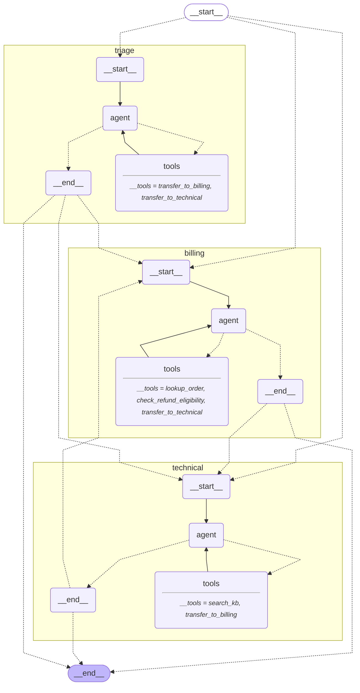

# Support swarm (peer handoffs)

> Let a live support conversation move between billing, technical and front-desk agents without making the customer repeat themselves, resuming with whoever last held it on the next message.

| | |
|---|---|
| **Example id** | `support_swarm` |
| **Category** | Multi-agent |
| **Difficulty** | advanced |
| **Models** | OpenAI chat |
| **Data** | `store.sqlite`, `kb/support` |
| **LangGraph features** | Command.PARENT handoffs from tools, agents as subgraphs, persistent active_agent routing from START, scoped tool sets, handoff and tool-round bounds |
| **Source** | [`src/deepdive/examples/support_swarm.py`](../../src/deepdive/examples/support_swarm.py) |

---

## Problem

In a customer chat the right specialist changes mid-conversation. It starts as a billing question ("can I return
the plug from order 1828?") and turns into a device fault ("also, my camera keeps going offline"). A router that
decides once, at the start, keeps the customer with the wrong specialist; sending them back to the front desk makes
them repeat themselves. Customers hate both.

## Design

A *swarm*: three peer agents - `triage`, `billing`, `technical` - and no central supervisor. Whoever holds
the conversation decides when to pass it on, by calling a transfer tool. Each agent is a small ReAct loop
(model <-> tools) that is given ONLY its own tools, so it cannot answer outside its remit:

  * triage    transfer_to_billing, transfer_to_technical. It never solves anything.
  * billing   lookup_order, check_refund_eligibility, transfer_to_technical. Order facts come from tools reading
              `store.sqlite`; the 30-day return rule is plain code, not model judgement, and is evaluated against a
              fixed `AS_OF` date so every run gives the same answer. It cannot issue refunds (no write tool).
  * technical search_kb (public BM25 support articles, with ids to cite), transfer_to_billing.

The conversation lives in one shared `messages` list, so a specialist sees everything said so far. The parent
graph also keeps `active_agent` in state and routes `START` to it, so the *next* user message on the same
thread resumes with whoever last held the conversation - not with triage.

Things a swarm gets wrong if you do not design for them, and what is done here:
  * Message history must stay valid for OpenAI: a tool call needs a matching tool message right after it. A transfer
    leaves the agent's subgraph and the subgraph's own pending messages are dropped (checked: returning only the
    `ToolMessage` leaves an orphaned tool message in the parent), so the transfer tool returns the whole history plus
    its `ToolMessage` (`add_messages` de-duplicates by id). Models are bound with `parallel_tool_calls=False` and any sibling tool
    call in the same message is answered with "not executed", so nothing is ever orphaned.
  * Ping-pong: with no supervisor, nothing stops billing -> technical -> billing -> ... forever. Transfers are capped
    per user turn (`MAX_HANDOFFS_PER_TURN`); beyond it the tool refuses and the agent must answer. The count is
    derived from the message history, so it needs no counter to reset.
  * Runaway tool loops: an agent that keeps calling tools is cut off after `MAX_TOOL_ROUNDS` rounds with a fixed
    "a human will follow up" reply (no model call).

## Graph

```text
START --(route on active_agent)--> triage | billing | technical --> END
          each agent is a subgraph:  agent <-> tools   (ToolNode)
          a transfer tool returns Command(goto=<peer>, graph=Command.PARENT) and jumps across to the peer
```

## LangGraph features

* `Command(goto=..., graph=Command.PARENT, update=...)` returned from a tool: peer-to-peer handoff from inside a
  subgraph, updating `active_agent` and the shared messages in the same step
* agents as subgraphs sharing the parent's state keys (`messages`), each with its own tool set
* `add_conditional_edges(START, ...)` reading persisted state, so a thread continues with the right agent;
  needs a checkpointer (Studio threads supply one; tests pass `InMemorySaver`)
* `ToolNode` with `InjectedState` / `InjectedToolCallId` so a tool can see the history and answer its own call
* explicit bounds on handoffs and tool rounds (cheap defences against loops with no supervisor)

## Models and data

OpenAI chat with tool calling (default tier, one model call per agent step). Data: `store.sqlite` (orders,
order_items, products - read-only) and the public `support` knowledge base (`audience="public"`: the internal
refund approval matrix is never retrievable here).
Simulated / not production-grade: there is NO customer authentication - `lookup_order` returns any order by id,
so a real deployment must verify the customer first. Delivery dates are not in the database: delivery is assumed to
be `ASSUMED_TRANSIT_DAYS` (5) days after the order date, and the return window is evaluated on `AS_OF`
(2026-11-06: five days after the last order, so every "delivered" order counts as delivered). Nobody can actually escalate to a human: the agents say a human will
follow up, and a real system would need an `escalate_to_human` tool.

## Try it in Studio

Open a new thread and send the message (in chat mode, or as input)::

    {"messages": [{"role": "user", "content": "Hi, can I still return the Lumen Plug 4-pack from order 1828?"}]}

Watch `triage` transfer to `billing` (open the `handoffs` and `active_agent` state), then billing call
`lookup_order` and `check_refund_eligibility`. On the SAME thread send a second message::

    {"messages": [{"role": "user", "content": "Thanks. Separately my Cam Pro keeps dropping offline after the update."}]}

The run starts at `billing` (not triage), which transfers to `technical`; technical searches the knowledge base
and cites article ids. A third message about the refund returns to billing. Other orders to ask about: 1677
(outside the 30-day window), 1767 (delivered exactly 30 days ago: still eligible), 1836 (already refunded), 1840
(cancelled).

## Extend it

Add an `escalate_to_human` tool that `interrupt()`s for an agent to take over. Add identity verification before
`lookup_order`. Give each handoff a structured summary (order id, device, what was tried) instead of free text.

## Compiled graph

Drawn from the compiled graph by `scripts/gen_docs.py` (one level of subgraphs expanded).



## Example input

```json
{
  "messages": [
    {
      "role": "user",
      "content": "Hi, can I still return the Lumen Plug 4-pack from order 1828?"
    }
  ]
}
```

Run it: `uv run langgraph dev`, open Studio, choose `support_swarm`, paste the input above.
